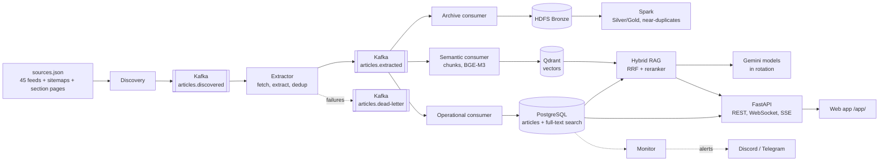

<div align="center">

# Vietnam SportsBot

**A multilingual sports news assistant that answers only from the news it has collected, and shows its sources.**

[](https://github.com/khoaaminh1/sportsbot_g4/actions/workflows/ci.yml)


[Architecture](#architecture) · [Status](#status) · [Quick start](#quick-start) · [Team](#team) · [Documentation](#documentation)

</div>

SportsBot collects sports news (football, tennis, basketball, volleyball, badminton, F1, athletics and more) from Vietnamese and international publishers, streams it through **Kafka** into **PostgreSQL** and a **Qdrant** vector index, archives it on **HDFS** for **Spark**, and answers questions in Vietnamese or English with **hybrid retrieval-augmented generation**. Every answer cites the articles it used, with links and publication times. When the collected news does not contain the answer, the bot says so instead of guessing.

<table>
<tr><td><b>Grounded answers</b></td><td>Keyword + vector search, reranking, numbered citations; no evidence means no LLM call.</td></tr>
<tr><td><b>Near real time</b></td><td>RSS discovery every 30-60 minutes per source, sitemap and section backfill, live feed in the web page over WebSocket.</td></tr>
<tr><td><b>Multilingual</b></td><td>Vietnamese, English, Spanish and French sources; questions in Vietnamese or English; follow-up questions understood ("anh ấy" after "Rooney").</td></tr>
<tr><td><b>Free to run</b></td><td>Open models on CPU (BGE-M3, bge-reranker-v2-m3 via llama.cpp) and free Gemini models in rotation.</td></tr>
<tr><td><b>Responsible crawling</b></td><td>robots.txt respected, one request per site every 3 s, failing sources backed off and reported.</td></tr>
</table>

## Architecture



Design decisions are recorded as ADRs: [streaming with Kafka](docs/decisions/0005-streaming-pipeline-kafka.md), [Gemini model rotation](docs/decisions/0006-llm-gemini-model-rotation.md), [BGE-M3 and reranker GGUF](docs/decisions/0007-bge-m3-and-reranker-gguf.md), and [earlier ones](docs/decisions/).

## Status

Presentation: **Thursday 12 November 2026** (moved from Tuesday 10; code freeze Wednesday 11 November, 12:00).
The system runs 24/7 on the team lead's PC (Windows 11, WSL2, Docker Desktop, i5-14400F, 32 GB)
and restarts by itself after a reboot.

**Last updated: 2026-11-12.** This section is the team's progress board: update it in the same
pull request that changes the state of a component.

### Corpus (from `make crawl-stats` and the web app)

| Date (ICT) | Articles | Vector chunks | Notes |
|---|---|---|---|
| 2026-11-03 01:41 | 963 | 2,966 | RSS only, 20 sources |
| 2026-11-03 23:32 | 11,838 | 34,875 | after sitemap + section backfill from 2026-09-01 and 28 multi-sport feeds |
| 2026-11-04 08:37 | 12,116 | n/a | overnight RSS only: about 30 new articles per hour |
| 2026-11-12 04:02 | 16,806 | 50,189 | live crawler PC, 45 sources; 629 new articles in the last 24 h |

45 of 48 feeds enabled (checked with `make sources-check` on 2026-11-03), 4 languages.
The private Kaggle dataset `minhkhoa132/sportsbot-corpus` holds snapshots; `export-summary.json`
in each version gives its article count and time.

### Data layers (medallion)

| Layer | What it is | Where | State | Owner |
|---|---|---|---|---|
| Operational | Clean articles for search and the chatbot | PostgreSQL + Qdrant | **Done**, live | TMK |
| **Bronze** | Raw, append-only archive: every extracted article as JSON Lines (plus raw RSS records) | Docker volume `bronze_data` on the crawler PC; `bronze.tgz` in Kaggle; loaded into HDFS with `make bronze-load` | **Done**, live | TMK |
| **Silver** | Cleaned, de-duplicated articles: exact duplicates removed, near-duplicates grouped into story clusters (MinHashLSH), Parquet | HDFS `/sportsbot/silver/` | **Done** 2026-11-05, run `20261105T150259Z` on the Kaggle snapshot exported 2026-11-03T08:53Z: 11,573 Bronze rows in, 11,573 Silver rows out, 0 rejected, 0 exact duplicates, 1,368 near-duplicate pairs in 28 story clusters (118 articles). Checked by hand (first run): 5 clusters (10 articles) are the same story from two outlets; 23 are within one outlet (108 articles), 17 of them VietNamNet, including one of 52 articles whose extracted text is the site's navigation menu (extractor issue, not a real story). MinHash LSH written in Spark SQL (the Spark image has no numpy). [Run report](docs/reports/runs/silver-20261105T150259Z.json). **Rerun 2026-11-09** (run `20261108T205819Z`, bronze.tgz exported 2026-11-09T03:56+07:00): 15,238 rows in, 15,232 out, 6 exact duplicates rejected, 1,915 near-duplicate pairs, 50 story clusters of 2 or more, 435 s. [Run report](docs/reports/runs/silver-20261108T205819Z.json) | VNP (rerun TMK) |
| **Gold** | Statistics for the report: articles per source/day/language, duplicate rate, cluster sizes, freshness lag | HDFS `/sportsbot/gold/` | **Done** 2026-11-05, run `20261105T154732Z` on Silver run `20261105T150259Z`: four tables (daily_counts, duplicates, cluster_sizes, freshness). **Rerun 2026-11-09** (run `20261108T215132Z`) on Silver `20261108T205819Z`; numbers below. [Run report](docs/reports/runs/gold-20261108T215132Z.json) | VNP (rerun TMK) |

Bronze is written by the streaming pipeline itself (`consumer-archive`), so it is complete.
Silver and Gold are batch Spark jobs that read Bronze; they are planned work, not missing
pieces of the pipeline. The HDFS + Spark cluster they run on (NameNode, 2 DataNodes, Spark
master + worker) is ready and checked by `make spark-smoke`. Specification with fixed rules:
[docs/handoff/VNP.md](docs/handoff/VNP.md), task 6.

#### Chatbot evaluation (run `eval-20261106T154709Z`, [report](docs/reports/runs/eval-20261106T154709Z.json))

50 golden questions (35 answerable, 15 not; 16 in English, 11 without diacritics), drafted before
looking at the corpus. Relevance was judged by TMK on the system's own top 10 (pooling, no
reranker threshold); only candidates with a reranker score of 0 or more were judged, so 19 of the
35 answerable questions have judgements. Recall is relative to that pool. Live settings:
reranker threshold -2.0, 12 reranked candidates, 5 articles to the model.

| Measure | Value |
|---|---|
| hit@1 / hit@5 / MRR@10 (19 judged questions) | 0.79 / 0.79 / 0.79 |
| recall@5 (19 judged questions) | 0.54 |
| Answerable questions answered (35) | 0.71 |
| Answers citing an expected article (19) | 0.74 |
| Unanswerable questions correctly refused (15) | 0.93 (q039, weather in Hanoi, was answered) |
| Seconds per question, p50 / p90 | 15.5 / 47.4 |

Known weakness: before the pool was widened, 13 of 35 answerable questions (most typed without
diacritics, some in English) had every candidate below the reranker threshold, so the bot said it
found nothing. Tuning the threshold on these judgements is the next retrieval step.

#### Sport classifier (run `20261108T213620Z`, [report](docs/reports/runs/classifier-20261108T213620Z.json))

Silver run `20261108T205819Z` (15,232 articles). Training: 5,393 articles with weak labels
(feed, URL path, volleyball/badminton title keywords; `ml/README.md`). Test: 193 articles labelled
by Claude (AI) and reviewed by TMK (`ml/labels/sport_test_v1.csv`), never used for training.
Spark standalone in Docker, 104 s for both models.

| Model | Accuracy | Macro-F1 | Macro-F1 vi (123) / en (23) / es (47) |
|---|---|---|---|
| Baseline: TF-IDF + logistic regression (Spark MLlib) | 0.570 | 0.544 | 0.362 / 0.639 / 1.000 |
| Improved: BGE-M3 vectors + logistic regression | **0.927** | **0.750** | 0.663 / 0.973 / 1.000 |

Findings: the baseline labels 56 of 147 football test articles as volleyball, almost all
Vietnamese: Vietnamese feeds are general sports sections, so most Vietnamese weak labels come
from the volleyball title rule and TF-IDF learns language instead of sport (weak-label bias).
BGE-M3 vectors avoid it. Spanish scores 1.0 because every Spanish article comes from one
football feed. Volleyball (2 test articles) and tennis (4) are too small to judge. The
weak-label holdout (1,298 articles; 0.947 / 0.974 accuracy) shares the training rules and
overstates quality.

#### Gold numbers (run `20261108T215132Z`, bronze.tgz exported 2026-11-09T03:56+07:00, [report](docs/reports/runs/gold-20261108T215132Z.json))

On Silver run `20261108T205819Z`, the same snapshot as the classifier. All accounting checks pass.

| Measure | Value |
|---|---|
| Silver articles / sources | 15,232 / 45 |
| By language | vi 8,707 · es 4,289 · en 2,207 · fr 29 |
| Exact duplicates rejected | 6 (0.04 %) |
| Near-duplicate articles (story cluster of 2 or more) | 204 (1.34 %) in 50 clusters |
| Clusters across two or more outlets (same story) | 6 clusters, 12 articles |
| Clusters within one outlet | 44 clusters, 192 articles; the largest has 62 articles (on the previous run the largest, 52 articles, was VietNamNet menu text from an extractor issue; not rechecked by hand on this run) |
| Lag `extracted_at - published_at`, median (p90) | RSS 1.33 h (221.9 h) · sitemap 1,023.8 h (1,219.2 h) · section pages 1,405.2 h (2,841.1 h) |
| Gold job duration | 24 s |

RSS lag shows the live pipeline: half of the RSS articles are stored within 1.3 hours of
publication. Sitemap and section-page lags measure how old the backfilled articles were
(September-November), not pipeline speed. Single machine, pseudo-distributed (Docker): 1 Spark
worker with 2 cores, 2 HDFS DataNodes. Previous Gold run on the 2026-11-03 snapshot (11,573
articles): [report](docs/reports/runs/gold-20261105T154732Z.json).

### Components

| Component | State |
|---|---|
| Kafka pipeline: discovery, extractor, 3 consumers, dead letters, replay | Running |
| Backfill from sitemaps and paginated sports sections | Running (manual command) |
| PostgreSQL full-text search (accent-insensitive) and Qdrant vectors (BGE-M3) | Running |
| Hybrid RAG with reranker and cited answers | Running |
| Conversation memory for follow-up questions | Merged and unit-tested; not yet checked live |
| FastAPI (`/chat`, `/chat/stream`, `/news/latest`, `/ws/news`, ...) and web app | Running |
| Monitoring, Discord / Telegram alerts, circuit breaker per source, restart after reboot | Running |
| Private Kaggle dataset and `make team-data` for teammates | Running |
| Public link (`make public-up`: Quick Tunnel, access code, rate limits) | Merged and unit-tested; not used for the demo (local demo) |
| HDFS + Spark stack | Ready (`make up-bigdata`, `make spark-smoke`) |

### What is left before the presentation

| Plan task | Work | Owner | State |
|---|---|---|---|
| 6 | Spark Silver + Gold jobs, run reports | VNP | Done 2026-11-05: Silver (PR #28) and Gold (PR #30) merged with run reports |
| 7 | Sport classifier: TF-IDF + logistic regression baseline vs BGE-M3 + logistic regression | TMK | Done 2026-11-09: run `20261108T213620Z`, BGE-M3 0.927 accuracy vs baseline 0.570 on 193 test articles (numbers above) |
| 9 | Scaling runs: Silver job at 2-3 sizes, `local[*]` vs cluster | VNP | Cut on 2026-11-09 (TMK decision): not needed for the presentation |
| 4 | 50 golden questions (`evaluation/golden_questions.csv`) | TMK | Done 2026-11-06: 50 questions, judgements for 19 answerable ones (PR #34) |
| 5 | Test labels for the classifier (at least 200) | TMK | Done 2026-11-09: 197 articles labelled by Claude, reviewed by TMK (193 in Silver) |
| - | Test rounds 1-3 with reports (`docs/reports/test-report-*.md`) | LTN | Pending: no report in the repository on 2026-11-11 |
| 8 | Retrieval and answer evaluation on the golden questions | TMK | Done 2026-11-06 (numbers above); reranker threshold tuning cut on 2026-11-09 |
| 10 | Slides, demo script, rehearsals, backup video | All | In progress 2026-11-11 |
| - | Answer latency (p50 15.5 s, p90 47.4 s in the evaluation run) | TMK | Open |

State on 2026-11-11 (code freeze): every planned component is built and measured; task 9
(scaling runs) and the optional tuning items were cut. Results at a glance, all from real runs
listed below:

- **Corpus**: 15,238 articles in the 2026-11-09 snapshot (45 sources, vi/es/en/fr); crawling
  continues 24/7. Half of the RSS articles are stored within 1.3 h of publication.
- **Spark (Silver/Gold)**: 6 exact duplicates removed, 1.34 % near-duplicates in 50 story
  clusters (MinHash LSH); Silver 435 s, Gold 24 s on a pseudo-distributed Docker cluster.
- **Sport classifier**: BGE-M3 + logistic regression 0.927 accuracy (macro-F1 0.750) vs TF-IDF
  baseline 0.570 (0.544) on 193 test articles.
- **Chatbot**: hit@1 0.79 on 19 judged questions; 93 % of unanswerable questions refused;
  answer time p50 15.5 s.

Original plan: [docs/plans/2026-11-02-plan-to-presentation.md](docs/plans/2026-11-02-plan-to-presentation.md).

## Quick start

Requirements: Docker (Docker Desktop with WSL2 on Windows), Python 3.11, Git, `make`, about 6 GB of free RAM.
Windows users work inside Ubuntu (WSL2); the full setup is in [docs/TEAM_ONBOARDING.md](docs/TEAM_ONBOARDING.md).

```bash
git clone https://github.com/khoaaminh1/sportsbot_g4.git && cd sportsbot_g4
python3 -m venv .venv && source .venv/bin/activate
cp .env.example .env          # add your own free GEMINI_API_KEY; never commit .env
make setup && make test
```

**Team members (use the shared corpus, no crawling):**

```bash
make team-data                # Kaggle download, models, start, import, build vectors
open http://localhost:8000/app/
```

**Crawler machine (collect news 24/7):**

```bash
make models                   # BGE-M3 + reranker GGUF, about 1.3 GB, once
make up-demo                  # Kafka, workers, PostgreSQL, Qdrant, AI services, backend
make backfill SINCE=2026-09-01 MAX=3000
make crawl-stats              # articles per source, vectors
```

`make help` lists every command. Stop everything with `make down` (data stays in Docker volumes).

## Team

| Member | Role | Owns |
|---|---|---|
| Trần Minh Khoa (TMK) | Lead | Pipeline and crawler PC, RAG, API and web app, evaluation, sport classifier, data sharing, merges, demo |
| Võ Ngọc Phú (VNP) | Data engineering | Spark Silver/Gold jobs, MinHash LSH near-duplicates, Spark image |
| Lê Tấn Nguyên (LTN) | Tester | Test rounds with reports and bug issues, slides draft |

**Work split with deadlines, checklists and how contributions are credited: [docs/TASKS.md](docs/TASKS.md).** Plan with daily gates: [docs/plans/2026-11-02-plan-to-presentation.md](docs/plans/2026-11-02-plan-to-presentation.md).

## Repository

| Path | Contents |
|---|---|
| [`pipelines/`](pipelines/) | Discovery, backfill, extractor, Kafka consumers, monitor, Spark jobs, CLI |
| [`pipelines/sources.json`](pipelines/sources.json) | Source registry: feeds, languages, time zones, sitemaps, section pages |
| [`agent/`](agent/) | Hybrid retrieval, reranker and embedding clients, LLM router, grounded answers, memory |
| [`backend/`](backend/) | FastAPI service matching [`docs/contracts/api.openapi.yaml`](docs/contracts/api.openapi.yaml) |
| [`frontend/`](frontend/) | Web app served at `/app/` (single page, no build step) |
| [`infra/`](infra/) | PostgreSQL migrations, HDFS configuration |
| [`ml/`](ml/), [`evaluation/`](evaluation/) | Classifier work, golden questions and metrics |
| [`docs/`](docs/) | Onboarding, data guide, contracts, ADRs, plans, runbooks, reports |

## How an answer is made

1. **Keyword search** in PostgreSQL over unaccented title and text ("doi tuyen viet nam" finds "Đội tuyển Việt Nam").
2. **Vector search** in Qdrant over 1,200-character chunks embedded with BGE-M3.
3. **Reciprocal Rank Fusion**, then **bge-reranker-v2-m3** drops weak candidates.
4. A follow-up question is first rewritten into a standalone query using the last turns of the conversation.
5. The LLM sees only the retrieved articles and must cite them as `[n]`; answers with invalid citations or URLs are replaced by article excerpts.
6. Free Gemini models are tried in turn; a model that hits its quota rests until the quota resets.

## Data and ethics

- The repository is public; **collected articles are not**. Full text belongs to the publishers, so the corpus is shared only inside the team through a **private** Kaggle dataset. See [docs/DATA.md](docs/DATA.md).
- Users see a title, a short excerpt and a link to the original article, never the full text.
- Crawling follows robots.txt and a per-site delay; blocked sites are not worked around (BBC pages are blocked from the team's network, so BBC items keep the feed summary only).
- No result in this project is invented: figures come from real runs with the command and date, public or synthetic data is labelled by origin, and the single-machine HDFS/Spark setup is described as pseudo-distributed, not as a production cluster.

## Documentation

| Read this | When |
|---|---|
| [Work split](docs/TASKS.md) | Who delivers what, by when; checklists; test cases |
| [Team onboarding](docs/TEAM_ONBOARDING.md) | First time on a machine: install, Kaggle data, run, common problems |
| [Data guide](docs/DATA.md) | What the snapshot files contain and how to load them |
| [Streaming stack runbook](docs/runbooks/streaming-stack.md) | Operating the crawler, backfill, monitoring, troubleshooting |
| [Public link runbook](docs/runbooks/public-access.md) | Share the web app with a free link (Cloudflare Quick Tunnel), access code, rate limits |
| [Chat runbook](docs/runbooks/chat.md) | RAG settings, Gemini rotation, conversation memory |
| [VNP handoff](docs/handoff/VNP.md) | Fixed rules of the Spark Silver/Gold jobs and the classifier (written before the runs) |
| [API contract](docs/contracts/api.openapi.yaml) | Endpoints; interactive docs at http://localhost:8000/docs |
| [AGENTS.md](AGENTS.md), [CONTRIBUTING.md](CONTRIBUTING.md) | Rules for people and AI assistants working in the repository |
| [Run reports](docs/reports/runs/), [model card](ml/README.md), [evaluation](evaluation/README.md) | Every number in Status: command, snapshot, date |
| [Decisions (ADRs)](docs/decisions/), [Phase 1 assessment](docs/reports/phase-1-assessment.md), [Phase 2 report](docs/reports/phase-2.md) | History: why the design is what it is (ADR 0004 is superseded by 0006) |

Contributions go through pull requests to the protected `main` branch; CI runs `make lint test` and a streaming end-to-end check.

---

Built by Group 4 for a university Big Data course. Architectural reference: [scitech-rag-agent](https://github.com/Tdat10052499/scitech-rag-agent) (MIT), studied, not copied. Use of AI assistance is documented as the course requires.
