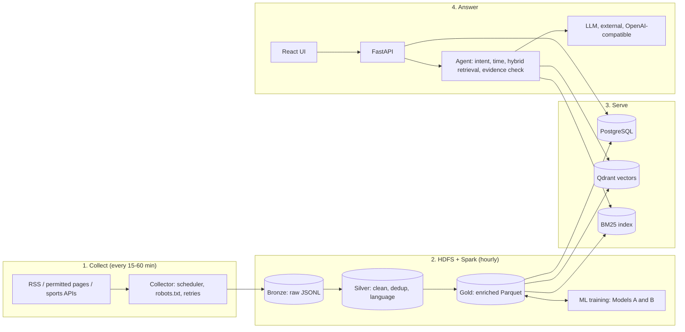

# Vietnam SportsBot


A real-time multilingual sports news chatbot. It continuously collects sports news from RSS feeds, permitted websites and sports APIs, processes it through a Big Data pipeline (HDFS + Apache Spark), and answers natural-language questions in **Vietnamese or English** using retrieval-augmented generation (RAG). Every answer cites the original articles with links and publication times, and says so when the evidence is missing or conflicting.

Initial focus: **Vietnamese football and volleyball**, with basketball, tennis and badminton next. The architecture is built to add sports, sources and languages later.

> **Status (2026-11-02): Phase 3 in progress.** Implemented and verified: the Docker stack (PostgreSQL, Qdrant, HDFS with 2 DataNodes, Spark), the backend foundation with health checks, the database schema, the frozen contracts, CI, and automatic news collection from 7 sources in 3 languages into HDFS ([Phase 2 report](docs/reports/phase-2.md), [ADR 0003](docs/decisions/0003-collection-and-bronze.md)). Spark Silver/Gold processing, ML, retrieval and the chatbot itself are still *planned*. Implemented features are marked as such, with the command that demonstrates them. Plan and decisions: [Phase 1 technical assessment](docs/plan/phase-1-assessment.md).

## Table of contents

1. [What it does](#what-it-does)
2. [Architecture in one picture](#architecture-in-one-picture)
3. [Implementation status](#implementation-status)
4. [Repository map](#repository-map)
5. [Data pipeline: Bronze, Silver, Gold](#data-pipeline-bronze-silver-gold)
6. [Data sources](#data-sources)
7. [NLP pipeline](#nlp-pipeline) and [AI and machine learning](#ai-and-machine-learning)
8. [Technology stack](#technology-stack)
9. [Quick start](#quick-start)
10. [API (planned)](#api-planned)
11. [Evaluation](#evaluation)
12. [Roadmap](#roadmap)
13. [Working on this repo](#working-on-this-repo)
14. [Team](#team)
15. [Honesty rules](#honesty-rules)
16. [Academic context and licence](#academic-context-and-licence)

## What it does

1. **Collects** new sports articles every 15–60 minutes per source (RSS first, official APIs second, permitted page extraction last). Each source has its own interval, and the collector respects robots.txt, terms of service and rate limits.
2. **Processes** them in hourly Spark micro-batches over HDFS: it cleans, validates, detects the language, removes exact and near-duplicate stories, classifies the sport and tags teams, athletes and competitions.
3. **Answers** questions such as:
   - "Tin bóng đá mới nhất hôm nay?" / "What are the latest football news today?"
   - "Give me the latest news about the Vietnam national football team."
   - "Show me recent volleyball news in Vietnam."
   - "What happened in Manchester United's latest match?"
4. **Shows its evidence.** Each answer lists the source articles with links and `published_at` times, and labels old news as old.
5. **Refuses to invent.** The bot never states a match result, statistic, transfer or injury that is absent from the retrieved evidence. When sources disagree, it shows the conflict and both sources. When a question is ambiguous (for example "Vietnam vs Indonesia": which team, age group, competition?), it asks for clarification.

"Real time" here means **near real time**: an article becomes searchable about one hour after collection, limited by how often each source publishes. Freshness lag is measured and reported, not assumed.

## Architecture in one picture



The request path never reads HDFS or runs Spark. HDFS keeps every raw and processed record, so any layer can be rebuilt. PostgreSQL, Qdrant and the BM25 index are serving copies refreshed after each Gold run.

## Implementation status

| Component | Status | Evidence |
|---|---|---|
| Project brief and Phase 1 assessment | Done | This README, [assessment](docs/plan/phase-1-assessment.md) |
| Local prototype (terminal + Streamlit, synthetic records, keyword matching) | Exists locally, **not published** | To be pushed to a branch for audit |
| Docker stack (core + bigdata profiles), PostgreSQL schema, contracts, CI | **Implemented** (Phase 2) | `make up-core`, `make up-bigdata`, `make spark-smoke`; [Phase 2 report](docs/reports/phase-2.md) |
| Backend foundation: config, JSON logging, errors, `/health` | **Implemented** (Phase 2) | `curl localhost:8000/health`; `make test` |
| Collectors and HDFS Bronze ingestion (7 RSS sources, vi/en/es) | **Implemented** (Phase 3a) | `make sources-check`, `make collect-once`, `make bronze-ls`; [ADR 0003](docs/decisions/0003-collection-and-bronze.md) |
| Spark Silver/Gold jobs, cross-source dedup, scaling experiments | Planned (Phase 3b) | — |
| Classifier, multilingual retrieval, RAG | Planned (Phase 4) | — |
| FastAPI backend | Planned (Phase 5) | — |
| Web frontend | Planned (Phase 6) | — |

## Repository map

Planned layout (created in Phase 2). Each Python module has its own `src/` package, `requirements.txt`, tests and `AGENTS.md`.

| Path | Purpose | Owner |
|---|---|---|
| `infra/` | HDFS, Spark and PostgreSQL configuration and migrations | TMK, VNP |
| `pipelines/` | Collectors, Bronze writer, Spark Silver/Gold jobs, deduplication, enrichment, exports, scaling scripts | VNP, LTN |
| `pipelines/sources.yaml` | Source registry: URL, language, interval, robots.txt result, licence notes | LTN |
| `ml/` | Datasets, labeling guide, training and evaluation of the classifiers, model cards | LTN |
| `agent/` | Query understanding, time parsing, hybrid retrieval, evidence and conflict checks, prompts, LLM client | TMK |
| `backend/` | FastAPI service exposing the API contract | TMK |
| `evaluation/` | Golden question set, retrieval and answer metrics, committed run files, reports | LTN, TMK |
| `frontend/` | Web UI (Phase 6) | LTN, TMK |
| `docs/` | Contracts, architecture decision records (ADRs), plan, runbooks, reports, journals | All |
| `.github/` | CI, issue and PR templates, CODEOWNERS | TMK |
| `data/` | Local data, logs and indexes (git-ignored, never committed) | — |

## Data pipeline: Bronze, Silver, Gold

| Layer | Location | Format | Contents |
|---|---|---|---|
| Bronze | `hdfs:///sportsbot/bronze/source=<id>/ingest_date=<date>/ingest_hour=<hh>/` | JSON Lines (gzip) | Raw items exactly as fetched, with source URL, original timestamps, `collected_at`, HTTP status, collector version |
| Silver | `hdfs:///sportsbot/silver/articles/` | Parquet | Cleaned, validated, language-tagged, deduplicated articles; rejected records go to `silver/_rejected/` with a reason code |
| Gold | `hdfs:///sportsbot/gold/` | Parquet, partitioned by `sport` and `published_date` | Enriched articles (sport category, teams, athletes, competition) and analytics tables (volume per source, freshness lag, duplicate rate, top entities) |

**Processing steps (planned):**

1. Normalize timestamps to UTC, keeping the original string.
2. Strip HTML, canonicalize URLs, detect language.
3. Validate against `docs/contracts/article.schema.json`.
4. Exact deduplication with `content_hash` (SHA-256 of normalized title + body) and canonical URL.
5. Near-duplicate clustering with Spark `MinHashLSH`, so the same story from two outlets shares a `story_cluster_id` and both stay citable.
6. Enrichment: trained sport classifier, alias-dictionary entity tagging.
7. Export new Gold rows to PostgreSQL, Qdrant and the BM25 index.

Only new partitions are processed (incremental ingestion with per-source watermarks).

**Article schema** (fields may be empty when a source does not provide them; missing metadata is never invented):

`article_id`, `title`, `content`, `summary`, `source_name`, `source_url`, `published_at`, `collected_at`, `language`, `sport_category`, `teams`, `athletes`, `competition`, `content_hash`.

**Big Data experiments (planned).** The same Spark jobs run at 10,000, 100,000 and 1,000,000 records. Each run records input, output, duplicate and rejected counts, duration, throughput, storage size per layer and errors. Two setups are compared:

- Spark `local[*]` on one machine.
- A Spark standalone cluster with 2 workers over a 2-DataNode HDFS.

Both run on one host, so they are reported as **single-machine / pseudo-distributed**, not as a production cluster. Our collectors will not reach 1M real sports articles during the course. The large runs therefore use real public Vietnamese news corpora (UIT-ViON, VNTC, binhvq news-corpus), always labeled "public historical corpus, not collected by SportsBot". Synthetic data is used only for tests and is always labeled.

## Data sources

RSS feeds and official APIs come first. Page extraction is enabled per source only after checking robots.txt and the terms of service. Full text is stored for internal processing; the bot displays only a title, a short excerpt and a link to the original.

Live check on 2026-11-02 (`make sources-check`, from a GitHub-hosted runner in the US and from Vietnam):

| Source | Language | Type | Coverage | Status |
|---|---|---|---|---|
| Tuổi Trẻ Thể thao | Vietnamese | RSS | All sports, incl. volleyball | Working (50 entries) |
| VnExpress Thể thao | Vietnamese | RSS | All sports | Working from Vietnam (60 entries); HTTP 404 from the US runner |
| BBC Sport football, tennis, basketball | English | RSS | Football, tennis, basketball | Working (74 / 55 / 17 entries, all dated) |
| The Guardian Football | English | RSS | Football | Working (59 entries) |
| MARCA Fútbol | Spanish | RSS | Football | Working (47 entries) |
| L'Équipe | French | RSS | All sports | Disabled: HTTP 403 (access refused); a French replacement is needed |
| VFF, VPF, VFV official sites | Vietnamese | Official pages | Football, volleyball | Candidates; robots.txt to check |
| API-Football (API-Sports) | — | REST API, free tier 100 requests/day | Fixtures, results, standings | Candidate (later in Phase 3) |

The registry with intervals, timezones and notes is [`pipelines/sources.yaml`](pipelines/sources.yaml).

## NLP pipeline

Natural language processing runs through the whole system, from cleaning collected articles to understanding questions. Each task below is marked as trained (with its own evaluation) or rule/dictionary-based. All are **planned**.

| NLP task | Where it runs | Method | Type | Evaluated by |
|---|---|---|---|---|
| Language identification | Silver Spark job | `lingua` or fastText `lid.176` | Pretrained | Accuracy on a labeled sample |
| Text normalization (Unicode NFC, HTML removal, whitespace) | Silver Spark job | Rules | Rule-based | Unit tests |
| Vietnamese word segmentation | BM25 indexing and queries | `underthesea` or `pyvi` | Pretrained | Retrieval recall, segmented vs syllable tokens |
| Accent stripping | BM25 (queries typed without diacritics, e.g. "doi tuyen viet nam") | Rules | Rule-based | Retrieval recall on no-accent queries |
| Near-duplicate detection | Silver Spark job | MinHash over word shingles (`MinHashLSH`) | Algorithmic | Precision on hand-checked pairs |
| Sport-category text classification | Gold enrichment | TF-IDF baseline vs multilingual embeddings | **Trained (Model A)** | Macro-F1, per-language F1 |
| Named entity recognition (teams, athletes, competitions) | Gold enrichment, query understanding | Alias dictionaries now; a pretrained Vietnamese NER model as a stretch goal | Dictionary (stretch: pretrained) | Precision / recall / F1 on a hand-labeled set |
| Entity normalization (aliases, abbreviations: "ĐT Việt Nam", "Vietnam national team") | Gold enrichment, query understanding | Alias table mapping to one entity id | Dictionary | Unit tests, golden set |
| Time expression parsing ("hôm nay", "tuần trước", "last weekend") | Query understanding | Rules to date ranges | Rule-based | Unit tests |
| Query intent classification | Agent | TF-IDF baseline vs embeddings | **Trained (Model B)** | Macro-F1 |
| Multilingual sentence embeddings | Semantic and cross-lingual search | `intfloat/multilingual-e5-small` | Pretrained | recall@k, MRR per language |
| Grounded answer generation | Chat answers | LLM with retrieved evidence and citations | Pretrained (used as-is) | Faithfulness, citation accuracy |

## AI and machine learning

**RAG pipeline (planned):**

1. Understand the query: intent, sport, teams, athletes, competition, time window ("hôm nay", "last weekend").
2. Retrieve with hybrid search: BM25 (Vietnamese word segmentation plus an accent-stripped copy, for queries typed without diacritics) and multilingual dense vectors (`intfloat/multilingual-e5-small`), fused with reciprocal rank fusion and filtered by sport, language and date.
3. Check the evidence. With nothing relevant, the bot says so; with conflicting sources, it shows the conflict.
4. Generate a grounded answer with an LLM behind an OpenAI-compatible interface, in the user's language, with citations and timestamps.

**Trained models (planned):**

| Model | Task | Baseline | Improved | Notes |
|---|---|---|---|---|
| A (mandatory) | Sport category of an article: football, volleyball, basketball, tennis, badminton, other | Character n-gram TF-IDF + logistic regression (Spark MLlib, and scikit-learn as a check) | Multilingual-e5 embeddings + logistic regression | Hand-labeled test set (~600 articles); time-based and story-cluster splits to prevent leakage |
| B (second) | Query intent: latest news, match result, schedule, standings, athlete update, other | TF-IDF + logistic regression | Embeddings + logistic regression | ~600–900 hand-written Vietnamese and English questions |

Fine-tuning `xlm-roberta-base` is optional and will be kept only if it beats the improved model by a margin set before the run. **No LLM is trained or fine-tuned in this project.** Entity tagging uses alias dictionaries and time expressions use rules; neither is presented as a trained model.

## Technology stack

| Layer | Technology | Why |
|---|---|---|
| Language | Python 3.11 | One language for collectors, Spark jobs, ML and API |
| Collection | feedparser, httpx, trafilatura, APScheduler | RSS parsing, polite HTTP, article extraction, per-source schedules |
| Distributed storage | Hadoop HDFS 3.x (1 NameNode, 2 DataNodes) | Bronze/Silver/Gold storage with replication |
| Processing | Apache Spark (PySpark), Parquet, DuckDB for checks | Cleaning, dedup, enrichment, analytics, MLlib baseline |
| Application data | PostgreSQL | Articles, sources, collection runs, conversations |
| Retrieval | Qdrant, BM25, multilingual-e5-small | Hybrid multilingual search with metadata filters |
| NLP / ML | underthesea or pyvi, lingua or fastText language ID, scikit-learn, Hugging Face transformers | Vietnamese segmentation, language detection, classifiers |
| LLM | OpenAI-compatible client (hosted API or local Ollama; team decision pending) | Grounded answer generation |
| Backend | FastAPI, Pydantic | Typed API with OpenAPI docs |
| Frontend | React + Vite + TypeScript (Phase 6) | Responsive web UI over the API |
| Infrastructure | Docker Compose, GitHub Actions, ruff, pytest | One-command stack, CI on every PR |

Kafka, Airflow and Elasticsearch are deliberately **not** used: about 20 feeds polled every 15–60 minutes is not a stream, and one scheduler plus `spark-submit` is enough. Each choice will be recorded as an ADR in `docs/decisions/`.

## Quick start

> **Available since Phase 2.** Verified end to end in CI on a GitHub-hosted runner; not yet tried on every team laptop. Details and troubleshooting: [docs/runbooks/stack.md](docs/runbooks/stack.md).

Requirements: Docker with Compose v2.24+, Python 3.11, Git, `make`. Windows users: run everything inside WSL2 (Ubuntu 24.04), because Spark needs Java 17+ and Hadoop does not run natively on Windows. Measured idle memory for the whole stack is about 1.5 GiB (a running Spark job adds up to 2 GB); the `core` profile alone runs without HDFS and Spark.

```bash
git clone https://github.com/khoaaminh1/sportsbot_g4.git
cd sportsbot_g4
cp .env.example .env          # fill in values; never commit .env
make setup                    # dev tools and Python dependencies
make up-core                  # PostgreSQL, Qdrant, backend  -> http://localhost:8000/health
make up-bigdata               # HDFS (NameNode + 2 DataNodes), Spark, /sportsbot dirs
make spark-smoke              # Spark job writes and reads Parquet on HDFS
make test-integration         # tests against the running core stack
make lint test                # ruff + pytest, same as CI
make down                     # stop all services (data volumes are kept)
```

## API (planned)

FastAPI with OpenAPI documentation at `/docs`. The contract will be frozen in `docs/contracts/api.openapi.yaml` during Phase 2.

| Endpoint | Purpose |
|---|---|
| `GET /health/live`, `GET /health` | **Implemented.** Liveness, and readiness of PostgreSQL, Qdrant and HDFS |
| `POST /chat` | Ask a question; streamed answer with citations and timestamps |
| `GET /news/latest` | Latest articles, filterable by sport and language |
| `GET /news/search` | Keyword and semantic search |
| `GET /categories` | Sports and article counts |
| `GET /articles/{article_id}` | Article metadata, excerpt and original link |
| `GET /conversations/{id}` | Conversation history |

## Evaluation

All numbers will come from committed run files on a frozen data snapshot, with decision rules written before each run.

- **Retrieval:** recall@5/10 and MRR for BM25, dense and hybrid, overall and per language (Vietnamese, English, cross-lingual), on a golden set of about 80 questions including unanswerable ones.
- **Answers:** faithfulness, citation accuracy, timestamp presence, correct refusals.
- **Classifiers:** macro-F1, per-class precision/recall/F1, confusion matrix, F1 per language.
- **System:** p50/p95 latency of retrieval and full answers.
- **Freshness:** lag from `published_at` to `collected_at`, and from `collected_at` to searchable.
- **Robustness:** behaviour when no relevant data exists, when a source is down, and when collection is repeated.

## Roadmap

Proposed 11-week plan from 2026-11-02, pending the team's confirmation of the course deadline. Phases overlap; each ends with a gate merged from `develop` to `main` and a phase report.

| Phase | Weeks | Content | Gate |
|---|---|---|---|
| 1. Repository audit | 1 | Audit of this repo and the reference architecture; technical assessment | Plan approved by the team |
| 2. Core infrastructure | 1–2 | Docker stack, PostgreSQL, HDFS, Spark, CI, contracts, logging, config | Stack starts on a clean clone; CI green |
| 3. Data engineering | 2–5 | Collectors, Bronze/Silver/Gold on HDFS, dedup, scaling experiments | 7 days of unattended real collection; scaling table |
| 4. AI and ML | 4–7 | Classifiers, multilingual hybrid retrieval, RAG, evaluation | Models and RAG measured |
| 5. Backend | 6–8 | FastAPI endpoints, conversation management, integration tests | All 13 backend completion criteria pass |
| 6. Frontend | 8–9 | Chat, news feed, search, filters, article pages | UI uses the documented API only |
| 7. Testing and deployment | 9–10 | End-to-end, load, data-pipeline tests; Docker deployment | Demo reproduced from a clean clone |
| 8. Documentation | 10–11 | Guides, experiment reports, final report, contribution report | Report submitted |

Frontend work starts only after the backend completion criteria are verified, not just after the code is written.

## Working on this repo

- **Branches:** `main` (protected, release tags) and `develop` (integration). Feature branches are named `feature/<issue>-<slug>`, for example `feature/12-rss-collector`; fixes use `fix/...` and docs use `docs/...`.
- **Commits:** [Conventional Commits](https://www.conventionalcommits.org/) in English, for example `feat: add VnExpress RSS collector`.
- **Pull requests:** into `develop`, squash merge, CI green. Another member reviews contracts, schemas, Spark jobs and evaluation runs.
- **Language:** all code, identifiers, logs, configuration, documentation, issues and PRs are in English. Collected news stays in its original language.
- **Secrets:** configuration comes from environment variables listed in `.env.example`. Never commit `.env`, API keys, data files, model weights or notebook outputs.
- **Decisions:** recorded as ADRs in `docs/decisions/`.

`CONTRIBUTING.md` and `AGENTS.md` (instructions for humans and AI coding agents) will be added in Phase 2.

## Team

Group 4.

| Member | Code | Owns |
|---|---|---|
| Trần Minh Khoa (project lead) | TMK | Architecture, contracts, Docker stack, PostgreSQL, FastAPI backend, agent and RAG, integration, documentation |
| Võ Ngọc Phú | VNP | HDFS, Bronze writer and scheduling, Spark Silver/Gold jobs, deduplication, exports, Big Data experiments |
| Lê Tấn Nguyên | LTN | Source registry and collectors (with VNP), labeling, Models A and B, golden set, testing; frontend in Phase 6 |

## Honesty rules

These rules apply to the code, the reports and the presentation:

- Collected data, benchmarks and training results are never fabricated.
- Synthetic and public historical datasets are always labeled with their origin.
- Single-machine or pseudo-distributed runs are never presented as a production cluster.
- Implemented features are kept separate from planned ones in all documentation.
- Publication time, event time and collection time are kept separate.
- The chatbot states when information is unavailable instead of guessing.

## Academic context and licence

Developed for a Big Data course. The final report will explain the architecture, data provenance, processing decisions, evaluation results, failure cases and limitations. Use of AI assistance in implementation and reporting is documented as the course requires.

Architectural reference: [scitech-rag-agent](https://github.com/Tdat10052499/scitech-rag-agent) (MIT), used as an engineering reference and adapted, not copied.

Licence: to be decided by the team (a `LICENSE` file will be added). Collected articles remain the property of their publishers and are not redistributed.
