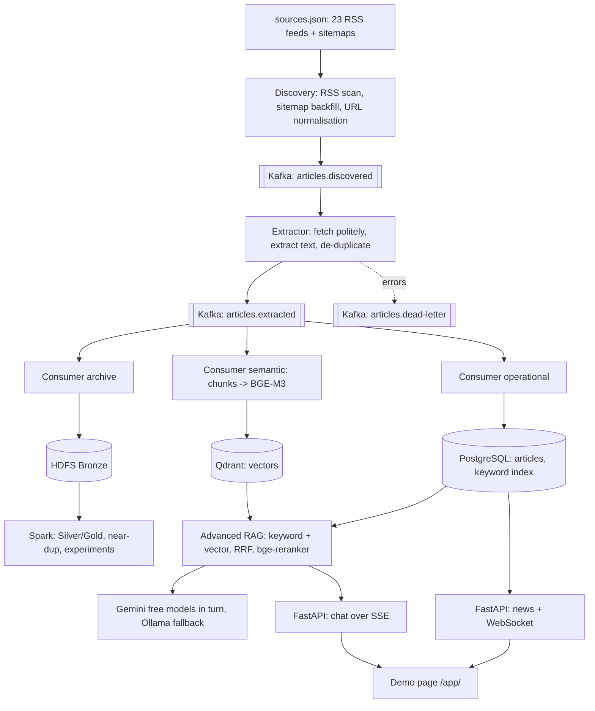

# Vietnam SportsBot


A near-real-time multilingual sports news chatbot. It collects sports news from Vietnamese and international sites, streams it through Kafka into PostgreSQL and a vector index, archives it to HDFS for Spark processing, and answers questions in **Vietnamese or English** only from the articles it has collected. Every answer cites its sources with links and publication times; without evidence, the bot says so instead of guessing.

> **Status (2026-11-02, branch `feature/stream-rag-skeleton`).** Presentation: **Tuesday 10 November 2026**. The pipeline from the team diagram is implemented as a working skeleton and tested (unit tests, PostgreSQL 16, Qdrant 1.19, and a CI job through a real Kafka broker). It has **not yet run on a team laptop with real news sites and the real models**: that is step 1 of the [plan](docs/plans/2026-11-02-speedrun-to-presentation.md). Spark Silver/Gold, the classifier and the evaluation are still to do. Earlier phases: [Phase 1 assessment](docs/plan/phase-1-assessment.md), [Phase 2 report](docs/reports/phase-2.md).

## Contents

1. [Architecture](#architecture)
2. [Implementation status](#implementation-status)
3. [Quick start (demo)](#quick-start-demo)
4. [Plan and team](#plan-and-team)
5. [Repository map](#repository-map)
6. [Data sources](#data-sources)
7. [RAG and models](#rag-and-models)
8. [API](#api)
9. [Big Data layer](#big-data-layer)
10. [Working on this repo](#working-on-this-repo)
11. [Honesty rules](#honesty-rules)

## Architecture



Decisions: [ADR 0005 streaming with Kafka](docs/decisions/0005-streaming-pipeline-kafka.md), [ADR 0006 Gemini rotation](docs/decisions/0006-llm-gemini-rotation-ollama-fallback.md), [ADR 0007 BGE-M3 + reranker GGUF](docs/decisions/0007-bge-m3-and-reranker-gguf.md). Earlier: [0001-0004](docs/decisions/).

## Implementation status

| Component | Status | How to see it |
|---|---|---|
| Docker stack, PostgreSQL schema, HDFS (2 DataNodes), Spark, CI | Done (Phase 2) | `make up-core`, `make up-bigdata`, `make spark-smoke` |
| RSS collector into HDFS Bronze (Phase 3a) | Done | `make collect-once`, `make bronze-ls` |
| Kafka topics, discovery, sitemap backfill | Skeleton, tested | `make up-stream`, `make backfill` |
| Extractor (trafilatura, robots.txt, URL + text dedup, dead letters) | Skeleton, tested | `make logs-stream`, `make dead-letters` |
| Operational consumer → PostgreSQL, accent-insensitive search (migration 003) | Skeleton, tested on PostgreSQL 16 | `make crawl-stats` |
| Semantic consumer → BGE-M3 → Qdrant | Skeleton, tested on Qdrant 1.19 with fake vectors | `make crawl-stats` (`qdrant_chunks`) |
| Hybrid RAG: keyword + vectors, RRF, bge-reranker, cited answers | Skeleton, unit-tested | `make ask Q="..."` |
| LLM router: Gemini models in rotation, Ollama fallback | Unit-tested; model names to verify with a key | `make llm-check` |
| FastAPI: `/chat`, `/chat/stream` (SSE), `/news/latest`, `/ws/news`, ... | Done, tested with fakes | http://localhost:8000/docs |
| Demo page (news feed + chat) | Done | http://localhost:8000/app/ |
| Spark Silver/Gold, near-duplicates (MinHashLSH), scaling runs | **To do** (plan task 6, 9) | — |
| Sport classifier (trained, evaluated) | **To do** (plan task 7) | — |
| Golden questions and retrieval evaluation | **To do** (plan task 4, 8) | — |
| Real models (BGE-M3, reranker) and real sites, end to end | **Not run yet** (plan task 1) | — |

Tests: `make test` runs 157 unit and contract tests (2026-11-02); `make test-integration` runs the database and stack tests.

## Quick start (demo)

Requirements: Docker (Docker Desktop or OrbStack on macOS; Docker Desktop + WSL2 on Windows), Python 3.11, Git, `make`. Full guide and troubleshooting: [docs/runbooks/streaming-stack.md](docs/runbooks/streaming-stack.md).

```bash
git clone https://github.com/khoaaminh1/sportsbot_g4.git && cd sportsbot_g4
git checkout feature/stream-rag-skeleton
cp .env.example .env      # set GEMINI_API_KEY (free: https://aistudio.google.com/apikey); never commit .env
make setup && make test   # Python tools, then all unit tests
make models               # BGE-M3 + reranker GGUF files (~1.3 GB, once)
make up-demo              # PostgreSQL, Qdrant, backend, Kafka, workers, embedder, reranker
make llm-check            # which Gemini models answer with your key
make discover-once        # start collecting now (the discover service also runs on a timer)
make crawl-stats          # articles per source, vectors in Qdrant
make ask Q="Tin bóng đá Việt Nam mới nhất?"
open http://localhost:8000/app/   # demo page (Windows: open the URL in a browser)
make down                 # stop (data is kept in Docker volumes)
```

Memory (estimate): `up-demo` about 3.5-4 GB; HDFS + Spark add 1.5-3.5 GB.

## Plan and team

Full plan with daily gates and step-by-step tasks: [docs/plans/2026-11-02-speedrun-to-presentation.md](docs/plans/2026-11-02-speedrun-to-presentation.md).

| Member | Code | AI assistant | Owns until 10 Nov |
|---|---|---|---|
| Trần Minh Khoa (lead) | TMK | Claude | Stack running 24/7 and crawling, RAG quality and evaluation, API and demo page, merges, demo |
| Võ Ngọc Phú | VNP | Claude | Spark Silver/Gold and near-duplicates, sport classifier, scaling experiment |
| Lê Tấn Nguyên | LTN | none | Source checks and sitemaps, hand labels, golden questions, slides, testing the demo page |

LTN works without an AI assistant, so LTN's tasks are commands to run and files to fill in, not code to write. Cut list if a gate slips: second model (already cut), public-corpus scaling, improved classifier, live HDFS in the demo.

## Repository map

| Path | Purpose |
|---|---|
| `pipelines/` | Discovery (RSS, sitemaps), extractor, Kafka consumers, Bronze writers, Spark jobs, CLI (`python -m sportsbot_pipelines --help`) |
| `pipelines/sources.json` | Source registry: URL, language, timezone, interval, domains, sitemaps |
| `agent/` | RAG: hybrid retrieval, reranker/embedding/Qdrant clients, LLM router, grounded answers, terminal tools |
| `backend/` | FastAPI: health, news, WebSocket feed, chat (JSON and SSE) |
| `frontend/index.html` | Demo page served by the backend at `/app/` (no build step) |
| `infra/` | PostgreSQL migrations (001-003), HDFS configuration |
| `evaluation/` | Golden questions and evaluation scripts |
| `scripts/download_models.sh` | Downloads the GGUF models |
| `docs/` | Contracts, ADRs, plans, runbooks, reports |

## Data sources

23 feeds in [`pipelines/sources.json`](pipelines/sources.json): 10 Vietnamese, 8 English, 3 Spanish, 2 French (one disabled). Seven were checked live on 2026-11-02 (VnExpress, Tuổi Trẻ, BBC × 3, Guardian, MARCA); the 15 added for the speed run are marked `"verified": false` until `make sources-check` confirms them (plan task 2).

Rules: robots.txt is respected (an unreadable robots.txt means skip), at most one request per site every 3 seconds, the User-Agent names the project and a contact. Full text is stored for processing only; users see the title, a short excerpt and the link to the original. RSS lists only recent items, so older articles come from sitemaps (`make backfill`). VnExpress answers only from Vietnamese IP addresses.

## RAG and models

1. **Keyword search** in PostgreSQL: full-text over unaccented title + text ("doi tuyen viet nam" finds "Đội tuyển Việt Nam").
2. **Vector search** in Qdrant: BGE-M3 (GGUF, llama.cpp) over 1,200-character chunks.
3. **Fusion** with Reciprocal Rank Fusion, then **reranking** with bge-reranker-v2-m3 (GGUF); weak candidates are dropped.
4. **Answer** with an LLM that sees only these articles and must cite `[n]`; answers with URLs or invalid citations are replaced by excerpts. No candidate → "no evidence", no LLM call.
5. **LLM router:** free Gemini models in turn (a model that hits its quota rests), then local Ollama.

Trained model (plan task 7): sport category of an article; TF-IDF + logistic regression (Spark MLlib) baseline vs BGE-M3 vectors + logistic regression, evaluated on hand labels. No LLM is trained or fine-tuned.

## API

Contract: [`docs/contracts/api.openapi.yaml`](docs/contracts/api.openapi.yaml) (version 0.3.0). Interactive docs at http://localhost:8000/docs.

| Endpoint | Purpose |
|---|---|
| `GET /health/live`, `GET /health` | Liveness and readiness (PostgreSQL, Qdrant, optional HDFS) |
| `POST /chat` | Answer with citations (`insufficient_evidence` when there is none) |
| `POST /chat/stream` | Same, as Server-Sent Events (`status`, `delta`, `citations`, `done`) |
| `GET /news/latest` | Latest articles, filter by sport and language, cursor paging |
| `GET /articles/{id}`, `GET /categories`, `GET /sources` | Article summary, sport counts, source status |
| `WS /ws/news` | Pushes newly stored articles to the browser |
| `GET /news/search`, `GET /conversations/{id}` | Planned |

## Big Data layer

- **Kafka:** 3 topics, 6 partitions keyed by source, two weeks of retention.
- **HDFS:** Bronze RSS records (collector) and full extracted articles (`consumer-archive`, set `STREAM_BRONZE_BACKEND=hdfs`). NameNode + 2 DataNodes, replication 2.
- **Spark (to do, plan task 6 and 9):** Silver (clean, exact and near-duplicate detection with `MinHashLSH`), Gold statistics, the MLlib baseline, and runs at increasing sizes comparing `local[*]` with the 2-worker standalone cluster. All on one machine: reported as pseudo-distributed, never as a production cluster.

## Working on this repo

- `main` is protected: pull requests only, CI (`lint-test`, `stack`) must pass.
- Branches `feature/...`, `fix/...`, `docs/...`; Conventional Commits in English.
- Configuration in `.env` (template: `.env.example`, checked by a test). Never commit `.env`, keys, data or model files.
- `AGENTS.md` and `CONTRIBUTING.md` hold the rules for people and AI assistants.

## Honesty rules

- Collected data, benchmarks and training results are never fabricated.
- Synthetic and public historical datasets are always labeled with their origin.
- Single-machine runs are never presented as a production cluster.
- Implemented and planned features are kept apart in all documentation (see the status table).
- Publication time, event time and collection time are kept separate.
- The chatbot says when information is unavailable instead of guessing.

Developed for a Big Data course by Group 4. Architectural reference: [scitech-rag-agent](https://github.com/Tdat10052499/scitech-rag-agent) (MIT), used as a reference, not copied. Use of AI assistance is documented as the course requires.
