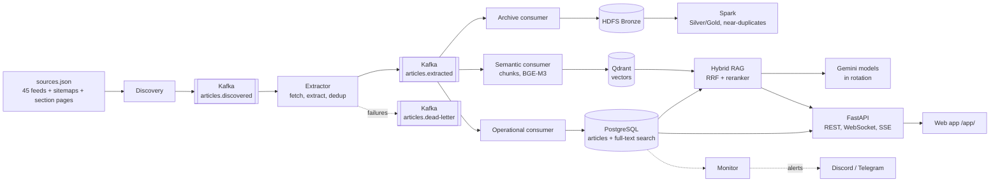

<div align="center">

# Vietnam SportsBot

**A multilingual sports news assistant that answers only from the news it has collected, and shows its sources.**

[](https://github.com/khoaaminh1/sportsbot_g4/actions/workflows/ci.yml)


[Architecture](#architecture) · [Status](#status) · [Quick start](#quick-start) · [Team](#team) · [Documentation](#documentation)

</div>

SportsBot collects sports news (football, tennis, basketball, volleyball, badminton, F1, athletics and more) from Vietnamese and international publishers, streams it through **Kafka** into **PostgreSQL** and a **Qdrant** vector index, archives it on **HDFS** for **Spark**, and answers questions in Vietnamese or English with **hybrid retrieval-augmented generation**. Every answer cites the articles it used, with links and publication times. When the collected news does not contain the answer, the bot says so instead of guessing.

<table>
<tr><td><b>Grounded answers</b></td><td>Keyword + vector search, reranking, numbered citations; no evidence means no LLM call.</td></tr>
<tr><td><b>Near real time</b></td><td>RSS discovery every 30-60 minutes per source, sitemap and section backfill, live feed in the web page over WebSocket.</td></tr>
<tr><td><b>Multilingual</b></td><td>Vietnamese, English, Spanish and French sources; questions in Vietnamese or English; follow-up questions understood ("anh ấy" after "Rooney").</td></tr>
<tr><td><b>Free to run</b></td><td>Open models on CPU (BGE-M3, bge-reranker-v2-m3 via llama.cpp) and free Gemini models in rotation.</td></tr>
<tr><td><b>Responsible crawling</b></td><td>robots.txt respected, one request per site every 3 s, failing sources backed off and reported.</td></tr>
</table>

## Architecture



Design decisions are recorded as ADRs: [streaming with Kafka](docs/decisions/0005-streaming-pipeline-kafka.md), [Gemini model rotation](docs/decisions/0006-llm-gemini-model-rotation.md), [BGE-M3 and reranker GGUF](docs/decisions/0007-bge-m3-and-reranker-gguf.md), and [earlier ones](docs/decisions/).

## Status

Presentation: **Tuesday 10 November 2026**. The system runs 24/7 on the team lead's PC (Windows 11, WSL2, Docker Desktop, i5-14400F, 32 GB).

| Component | State |
|---|---|
| Kafka pipeline: discovery, extractor, 3 consumers, dead letters, replay | Running |
| Backfill from sitemaps and paginated sports sections | Running |
| PostgreSQL full-text search (accent-insensitive) and Qdrant vectors (BGE-M3) | Running |
| Hybrid RAG with reranker and cited answers | Running |
| Conversation memory for follow-up questions | Merged and unit-tested; first live check pending |
| FastAPI (`/chat`, `/chat/stream`, `/news/latest`, `/ws/news`, ...) and web app | Running |
| Monitoring with Discord / Telegram alerts, circuit breaker per source | Running |
| Private Kaggle dataset for sharing the corpus inside the team | Running |
| HDFS + Spark stack (NameNode, 2 DataNodes, Spark 3.5) | Ready; Silver/Gold jobs in progress |
| Spark near-duplicate detection, sport classifier, scaling runs | In progress (VNP) |
| Golden questions, hand labels, retrieval evaluation | In progress (LTN, TMK) |

Measured on 2026-11-03: 1,240 articles stored, 4 languages, 20 sources active before the 28 multi-sport feeds were added. Corpus figures in reports always come from `make crawl-stats` with the date.

## Quick start

Requirements: Docker (Docker Desktop with WSL2 on Windows), Python 3.11, Git, `make`, about 6 GB of free RAM.
Windows users work inside Ubuntu (WSL2); the full setup is in [docs/TEAM_ONBOARDING.md](docs/TEAM_ONBOARDING.md).

```bash
git clone https://github.com/khoaaminh1/sportsbot_g4.git && cd sportsbot_g4
python3 -m venv .venv && source .venv/bin/activate
cp .env.example .env          # add your own free GEMINI_API_KEY; never commit .env
make setup && make test
```

**Team members (use the shared corpus, no crawling):**

```bash
make team-data                # Kaggle download, models, start, import, build vectors
open http://localhost:8000/app/
```

**Crawler machine (collect news 24/7):**

```bash
make models                   # BGE-M3 + reranker GGUF, about 1.3 GB, once
make up-demo                  # Kafka, workers, PostgreSQL, Qdrant, AI services, backend
make backfill SINCE=2026-09-01 MAX=3000
make crawl-stats              # articles per source, vectors
```

`make help` lists every command. Stop everything with `make down` (data stays in Docker volumes).

## Team

| Member | Role | Owns |
|---|---|---|
| Trần Minh Khoa (TMK) | Lead | Pipeline and crawler PC, RAG, API and web app, data sharing, merges, demo |
| Võ Ngọc Phú (VNP) | Data engineering and ML | Spark Silver/Gold, near-duplicates, sport classifier, scaling experiment |
| Lê Tấn Nguyên (LTN) | Data quality and evaluation | Source checks, hand labels, golden questions, slides, UI testing |

Plan with daily gates: [docs/plans/2026-11-02-plan-to-presentation.md](docs/plans/2026-11-02-plan-to-presentation.md).

## Repository

| Path | Contents |
|---|---|
| [`pipelines/`](pipelines/) | Discovery, backfill, extractor, Kafka consumers, monitor, Spark jobs, CLI |
| [`pipelines/sources.json`](pipelines/sources.json) | Source registry: feeds, languages, time zones, sitemaps, section pages |
| [`agent/`](agent/) | Hybrid retrieval, reranker and embedding clients, LLM router, grounded answers, memory |
| [`backend/`](backend/) | FastAPI service matching [`docs/contracts/api.openapi.yaml`](docs/contracts/api.openapi.yaml) |
| [`frontend/`](frontend/) | Web app served at `/app/` (single page, no build step) |
| [`infra/`](infra/) | PostgreSQL migrations, HDFS configuration |
| [`ml/`](ml/), [`evaluation/`](evaluation/) | Classifier work, golden questions and metrics |
| [`docs/`](docs/) | Onboarding, data guide, contracts, ADRs, plans, runbooks, reports |

## How an answer is made

1. **Keyword search** in PostgreSQL over unaccented title and text ("doi tuyen viet nam" finds "Đội tuyển Việt Nam").
2. **Vector search** in Qdrant over 1,200-character chunks embedded with BGE-M3.
3. **Reciprocal Rank Fusion**, then **bge-reranker-v2-m3** drops weak candidates.
4. A follow-up question is first rewritten into a standalone query using the last turns of the conversation.
5. The LLM sees only the retrieved articles and must cite them as `[n]`; answers with invalid citations or URLs are replaced by article excerpts.
6. Free Gemini models are tried in turn; a model that hits its quota rests until the quota resets.

## Data and ethics

- The repository is public; **collected articles are not**. Full text belongs to the publishers, so the corpus is shared only inside the team through a **private** Kaggle dataset. See [docs/DATA.md](docs/DATA.md).
- Users see a title, a short excerpt and a link to the original article, never the full text.
- Crawling follows robots.txt and a per-site delay; blocked sites are not worked around (BBC pages are blocked from the team's network, so BBC items keep the feed summary only).
- No result in this project is invented: figures come from real runs with the command and date, public or synthetic data is labelled by origin, and the single-machine HDFS/Spark setup is described as pseudo-distributed, not as a production cluster.

## Documentation

| Read this | When |
|---|---|
| [Team onboarding](docs/TEAM_ONBOARDING.md) | First time on a machine: install, Kaggle data, run, common problems |
| [Data guide](docs/DATA.md) | What the snapshot files contain and how to load them |
| [Streaming stack runbook](docs/runbooks/streaming-stack.md) | Operating the crawler, backfill, monitoring, troubleshooting |
| [Chat runbook](docs/runbooks/chat-prototype.md) | RAG settings, Gemini rotation, conversation memory |
| [VNP handoff](docs/handoff/VNP.md) | Spark and classifier tasks, with rules for VNP's AI assistant |
| [API contract](docs/contracts/api.openapi.yaml) | Endpoints; interactive docs at http://localhost:8000/docs |
| [AGENTS.md](AGENTS.md), [CONTRIBUTING.md](CONTRIBUTING.md) | Rules for people and AI assistants working in the repository |

Contributions go through pull requests to the protected `main` branch; CI runs `make lint test` and a streaming end-to-end check.

---

Built by Group 4 for a university Big Data course. Architectural reference: [scitech-rag-agent](https://github.com/Tdat10052499/scitech-rag-agent) (MIT), studied, not copied. Use of AI assistance is documented as the course requires.
