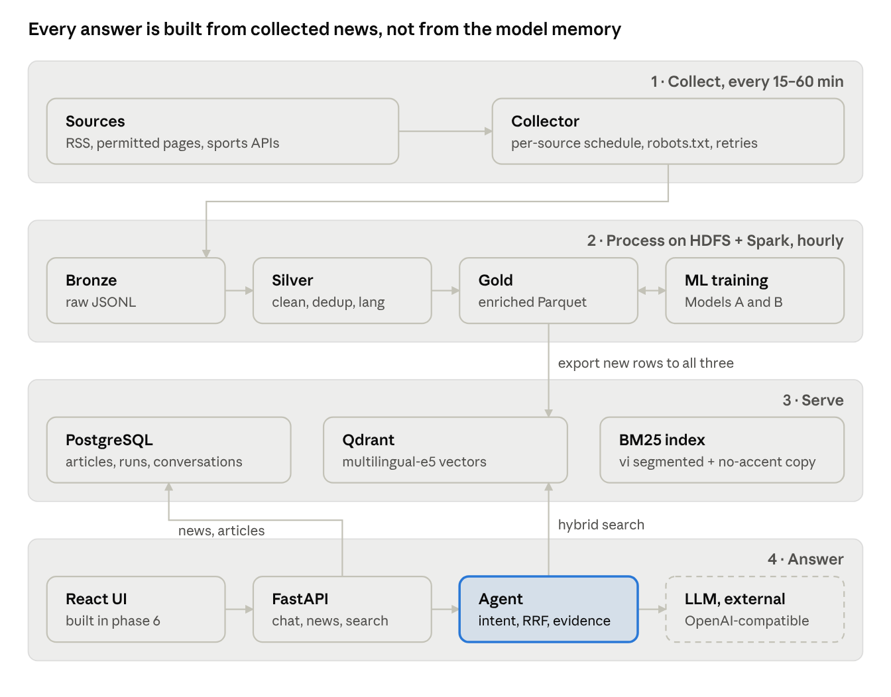
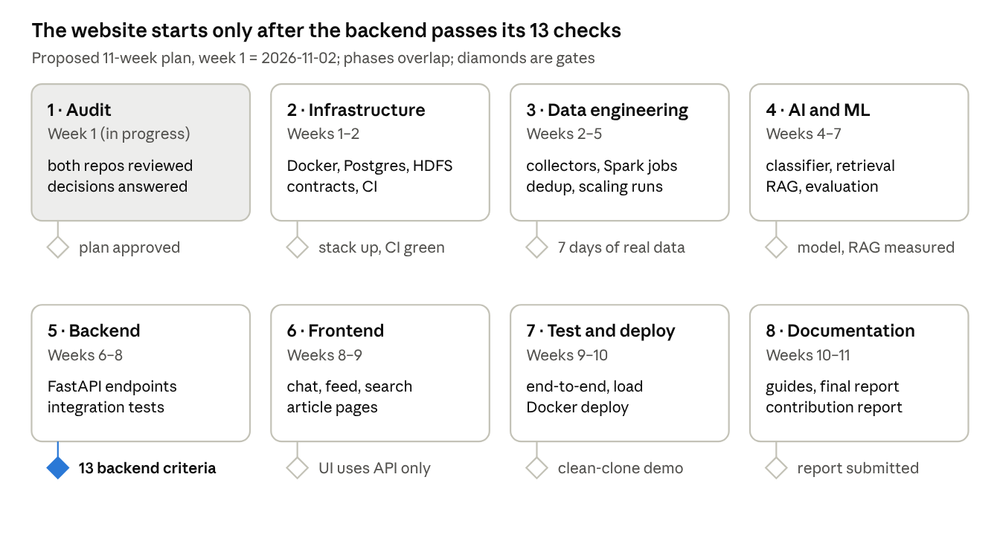

# Vietnam SportsBot — Phase 1 Technical Assessment

Written 2026-11-02 (Phase 1). A snapshot of the plan at that date; later changes are recorded in `docs/decisions/` and the phase reports.

**SportsBot starts from zero code, and the reference covers only half of what our brief requires.** It is a strong template for RAG, process and evaluation, but it has no HDFS, no trained model and no Vietnamese retrieval. We should copy its practices and contracts, adapt its retrieval and agent code (MIT), and build the four missing parts new: multi-source collectors, HDFS Bronze/Silver/Gold with Spark, a trained multilingual classifier, and multilingual hybrid retrieval.

- **Current state:** `sportsbot_g4` holds one README. The terminal/Streamlit prototype it mentions is unpublished.
- **Architecture:** collectors → HDFS Bronze → Spark Silver/Gold (hourly micro-batches) → Postgres + Qdrant + BM25 → FastAPI agent → React UI (last).
- **Big Data evidence:** incremental Spark jobs on a 2-DataNode HDFS, MinHashLSH near-dedup, scaling runs at 10k / 100k / 1M using labeled public Vietnamese news corpora for the large sizes.
- **ML evidence:** sport-category classifier (Spark MLlib TF-IDF baseline vs multilingual-e5 + logistic regression), hand-labeled test set, time- and cluster-based splits; query-intent classifier as a second model.
- **Effort:** about 115 person-days (estimate), about 11 weeks for three people with buffer.
- **Needed from you:** the deadline, the LLM choice, and five more decisions at the end of this doc.

## 1. Reference repository architecture (scitech-rag-agent)

The reference is a finished, well-run course RAG project worth copying in process, but it covers only half our brief. It has no HDFS, no trained ML model, and English-only retrieval. Audited at commit `ae89896` (2026-11-01), about 350 files and 9,800 lines of Python.

**What it builds.** A chat app that answers LLM/NLP research questions from 121,860 arXiv `cs.CL` abstracts, with numbered citations, an explicit "insufficient evidence" refusal, and follow-up suggestions. Three members, 2026-10-13 to 2026-11-06, presented 2026-11-10.

| Layer | Module | What it does | Key choices |
| --- | --- | --- | --- |
| Data | `pipelines/` | download, profile, clean, validate, chunk, embed, load, incremental run | PySpark `local[*]` for clean; DuckDB for count checks; Parquet; OAI-PMH watermark ingestion every 2 h |
| Retrieval | `agent/.../retrieval/` | dense, BM25, hybrid behind one `Retriever` protocol | Qdrant + `bge-small-en-v1.5`; Okapi BM25; reciprocal rank fusion (`rrf_k` 60) |
| Agent | `agent/` | query rewrite, retrieve, evidence check, cited answer, follow-ups, traces | Prompts in `agent/prompts/*.md`; request budget (max LLM calls, timeout) |
| API | `backend/` | FastAPI: `/health`, `/chat` (SSE stream), `/feedback` | Agent behind a port/adapter, so a demo agent runs without an index or LLM |
| UI | `frontend/` | React + Vite + TypeScript chat | Talks to the backend only through `api.openapi.yaml` |
| Evaluation | `evaluation/` | golden set (47 items), recall@k, MRR, bootstrap CIs, faithfulness, ablations | Frozen index snapshot for all runs |
| LLM | outside the stack | OpenAI-compatible client | `llama3.2:3b` on Ollama (Kaggle T4 via tunnel, laptop CPU fallback) |

**Engineering practices worth adopting as-is:**

- **Contracts first.** `docs/contracts/` freezes the chunk JSON schema, the OpenAPI spec and the LLM client interface in week 1, and CI tests them. Modules then work in parallel.
- **ADRs with a decision rule written before the numbers.** For example, ADR 0007 picked the embedding model by a recall@5 margin fixed before the run. This is the most academically defensible habit in the repo.
- **Honest measurement.** ADR 0005 benchmarks PySpark vs DuckDB vs Polars on real and labeled-synthetic data, states machine specs, and separates cold from warm runs. `pipelines/reports/scaling.md` measures 10% / 50% / 100% index sizes.
- **Process scaffolding.** `AGENTS.md`, `CONTRIBUTING.md` (GitHub Flow, Conventional Commits, squash merge), issue templates, CODEOWNERS, a CI workflow (ruff + pytest + frontend build), a one-off workflow that creates labels and milestones, per-day task briefs, and per-member journals.
- **One-command stack.** `docker-compose.yml` runs Qdrant, backend and frontend; the LLM stays outside behind `LLM_BASE_URL`.

**Where it does not fit our brief:**

- **No HDFS or Hadoop.** Spark runs in local mode on files. Our brief requires HDFS storage that works (completion criterion 4).
- **No trained ML model.** ADR 0002 chose RAG over training. Our brief makes at least one trained and evaluated model mandatory.
- **English only.** ADR 0007 dropped Vietnamese questions because the embedding model is English-only. Multilingual retrieval is central for us.
- **Static, licensed corpus.** arXiv is one CC0 bulk dump with one daily update. Sports news is many small feeds, copyrighted content, and hourly updates, so collection is a much bigger share of our work.
- **No structured data store.** No PostgreSQL; nothing like match results, teams or athletes.

## 2. Current SportsBot repository status

`sportsbot_g4` contains one file: a 144-line `README.md` (commit `4b4676f`, 2026-11-02). There is no source code, no dependency file, no CI, no Docker setup and no data yet.

The README says a local prototype exists but is unpublished: a terminal UI, a Streamlit UI, synthetic sports records and basic keyword matching. Its direction mostly agrees with the master brief, with five differences the team must settle:

| Topic | README says | Master brief says | Recommendation |
| --- | --- | --- | --- |
| Web UI | Streamlit, hosted on Streamlit Community Cloud | FastAPI backend first, then a modern responsive website consuming the API | FastAPI + a small React (Vite) frontend; keep Streamlit only as an optional internal demo |
| App database | SQLite | PostgreSQL | PostgreSQL in Docker (same SQL; needed for concurrent collector + API writes) |
| Terminal UI | argparse + Rich, sharing services with the web UI | Not mentioned | Keep as a thin CLI over the same services; it is cheap and useful for demos |
| ML model | Intent classifier is optional | At least one trained model is mandatory | Mandatory: sport-category classifier (section 8), intent classifier as second |
| Structured match results | Planned (results, schedules, standings) | Mentions sports APIs; focus is news | Phase 2 stretch goal via one free API; news RAG comes first |

The README's honesty rules already match the brief: synthetic data labeled, a local Hadoop is a teaching setup, publication vs event vs collection time kept separate.

## 3. Existing source code and reusable components

Nothing in `sportsbot_g4` is reusable code yet. The unpublished prototype should be pushed first so it can be audited. Most reuse comes from the reference, which is MIT-licensed, so code can be adapted with attribution.

| Reference component | Path | Reuse | Change needed for SportsBot |
| --- | --- | --- | --- |
| RRF hybrid fusion | `agent/.../retrieval/hybrid.py` | Adapt | Add metadata filters (sport, language, date window) and a recency boost |
| `Retriever` protocol + dense / BM25 retrievers | `agent/.../retrieval/` | Adapt | Multilingual embedding model; BM25 tokenizer must handle Vietnamese (word segmentation or syllable n-grams) |
| Evidence check + refusal | `agent/.../evidence.py` | Adapt | Sports-specific refusal text; conflict detection between sources |
| OpenAI-compatible LLM client + fake | `agent/.../llm.py` | Reuse | None beyond config |
| Prompt files | `agent/prompts/*.md` | Pattern | Rewrite for sports: never state scores or transfers absent from evidence; always print dates |
| SSE `/chat` + port/adapter + demo agent | `backend/src/app/` | Adapt | Add news, search, category, article and conversation endpoints |
| Contract files | `docs/contracts/` | Pattern | Our `article.schema.json` (the brief's 14 fields) and our OpenAPI spec |
| Evaluation harness | `evaluation/src/scitech_eval/` | Adapt | Add classifier metrics (P/R/F1), multilingual groups, freshness and attribution checks |
| Engine benchmark + scaling scripts | `pipelines/scripts/bench_engines.py`, `scaling.py` | Pattern | Run on Spark over HDFS at 10k / 100k / 1M records |
| CI, issue templates, label/milestone bootstrap | `.github/` | Reuse | Rename labels and milestones to our phases |
| `AGENTS.md`, `CONTRIBUTING.md`, ADR template, task brief template | root, `docs/` | Reuse | Our names, codes (TMK, VNP, LTN) and dates |
| Docker Compose stack | `docker-compose.yml` | Adapt | Add PostgreSQL, HDFS NameNode + DataNode, Spark, collector service |

## 4. Missing components

Everything in the brief is missing from `sportsbot_g4`. The pieces below are also missing from the reference, so they need new design rather than adaptation:

1. **Multi-source news collectors.** Per-source RSS adapters, a robots.txt and rate-limit guard, retries, a source registry with per-source intervals, and failure statistics.
2. **Article extraction.** RSS items often carry only a title and summary, so full text needs permitted-page extraction (`trafilatura` or Beautiful Soup).
3. **HDFS storage.** NameNode + DataNode containers, Bronze/Silver/Gold paths, and a writer from the collector into Bronze.
4. **Spark over HDFS.** Jobs that read Bronze from `hdfs://`, write Silver and Gold Parquet, and log the brief's 8 experiment metrics.
5. **Near-duplicate detection across sources.** The same story from VnExpress and Thanh Niên differs in wording, so `content_hash` alone misses it; this needs MinHash or embedding similarity.
6. **Sports entity extraction.** Teams, athletes, competitions, with alias dictionaries ("ĐT Việt Nam", "Vietnam national team", "Những chiến binh sao vàng").
7. **A trained classifier.** Dataset, splits, a baseline, an improved model, a model card.
8. **Multilingual retrieval.** Multilingual embeddings, Vietnamese-aware BM25, metadata filters for sport, language and date.
9. **Time understanding.** "hôm nay", "last week", "latest match" turned into date filters; recency in ranking; old vs new news labeled in answers.
10. **PostgreSQL schema.** Articles, sources, collection runs, conversations, messages.
11. **Extra API endpoints.** Latest news, search, categories, article detail, conversations.
12. **Freshness monitoring.** Lag between `published_at` and `collected_at`, and between `collected_at` and searchable.

## 5. Recommended final architecture

Four layers with one rule: the request path never touches HDFS or Spark, and the LLM only writes from evidence the agent hands it.



HDFS keeps every raw and processed record, so any layer can be rebuilt. Postgres, Qdrant and BM25 are serving copies refreshed after each Gold run. The agent understands the query (sport, entities, time window, intent), runs hybrid retrieval with filters, checks the evidence, and only then calls the LLM. If evidence is missing or conflicting, it says so.

## 6. Recommended technology stack with reasons

The stack is the reference's proven core (Python, FastAPI, Qdrant, hybrid BM25 + dense, Docker Compose, GitHub Actions) plus four additions the brief requires: HDFS, Spark over HDFS, PostgreSQL and multilingual models. Kafka, Airflow and Elasticsearch are left out, because nothing in our load needs them.

| Technology | Why needed / problem solved | Status | Integrates with | Feasible for us? |
| --- | --- | --- | --- | --- |
| Python 3.11 | One language for collectors, Spark jobs, ML, API | Mandatory | Everything | Yes |
| feedparser + httpx | Fetch RSS with timeouts, retries, conditional GET (ETag) | Mandatory | Collector → Bronze | Yes, low effort |
| trafilatura | Extract article body from permitted pages when RSS has only a summary | Mandatory | Collector | Yes |
| APScheduler in a `collector` container | Per-source intervals (for example every 15–60 min) without Airflow's overhead | Mandatory | Collector, Docker | Yes; the reference used a Python loop the same way |
| Hadoop HDFS 3.x (`apache/hadoop` image: 1 NameNode, 2 DataNodes) | Required distributed storage for Bronze/Silver/Gold; shows replication and block placement | Mandatory (brief) | Collector writes via WebHDFS; Spark reads `hdfs://` | Yes on one machine (pseudo-distributed); real multi-node is a stretch |
| Apache Spark (PySpark) | Cleaning, dedup (incl. `MinHashLSH`), enrichment, analytics, MLlib baseline over HDFS | Mandatory (brief) | HDFS in, Parquet out | Yes; the reference measured PySpark at 80 s for 5.6 GB on 4 CPUs |
| Parquet | Columnar, partitioned (`sport`, `date`) Silver/Gold layers; small on disk | Mandatory | Spark, DuckDB checks, exports | Yes |
| DuckDB | Quick checks, count reconciliation with Spark, notebook analytics | Optional | Parquet | Yes, trivial |
| PostgreSQL 16 | App data: articles, sources, collection runs, conversations; concurrent writes from collector and API | Mandatory (brief) | Gold export → Postgres; FastAPI reads it | Yes |
| Qdrant | Vector search with payload filters (sport, language, date) | Mandatory (a vector DB) | Gold export → Qdrant; agent queries it | Yes; reference ran it on a laptop |
| `intfloat/multilingual-e5-small` (384-d, 100+ languages, `query:` / `passage:` prefixes) | Cross-lingual search: a Vietnamese question finds an English article | Mandatory (multilingual) | Embedding job, query side | Yes on CPU; compare with `bge-m3` in an ADR |
| BM25 with Vietnamese segmentation (`underthesea` or `pyvi`) + an accent-stripped field | Exact names, scores and terms; queries typed without diacritics ("doi tuyen viet nam") | Mandatory | Hybrid retriever (RRF) | Yes |
| Language ID (`lingua` or fastText `lid.176`) | `language` field; per-language analysis | Mandatory | Silver job (UDF) | Yes |
| scikit-learn, Spark MLlib, Hugging Face `transformers` | Baseline and improved classifiers (section 8) | Mandatory | Gold enrichment, evaluation | Yes; GPU only for the optional fine-tune (Kaggle T4) |
| LLM via an OpenAI-compatible client | Grounded answer generation in Vietnamese and English | Mandatory | Agent | Needs a team decision: a hosted API (key, cost) or a local Ollama model; small models write weak Vietnamese |
| FastAPI + Pydantic | Typed API, OpenAPI docs for free, SSE streaming | Mandatory | Agent, Postgres, frontend | Yes; reference code adapts directly |
| React + Vite + TypeScript | Responsive web UI in phase 6 | Mandatory later | Backend API only | Yes; reference ADR 0004 |
| Docker Compose | One command for Postgres, HDFS, Spark, Qdrant, collector, backend | Mandatory | All services | Yes; RAM is the limit (about 8–10 GB for the full stack, estimate) |
| GitHub Actions, ruff, pytest | Lint + tests on every PR | Mandatory | Repo | Yes; copy the reference workflow |
| Kafka | Not needed: about 20 feeds polled every 15–60 min is not a stream | Not used | — | Revisit only if live match events are added |
| Airflow | Not needed: one scheduler loop plus `spark-submit` is enough | Not used | — | — |

## 7. Proposed Big Data workflow

Data moves in hourly micro-batches through three HDFS layers, and Spark touches only new partitions. Serving copies go to PostgreSQL, Qdrant and BM25. "Near real time" means "searchable within about one hour of collection". The report must say that, and measure it.

1. **Collect.** The collector polls each source on its own interval and writes raw items as JSON Lines to `hdfs:///sportsbot/bronze/source=<id>/ingest_date=<YYYY-MM-DD>/ingest_hour=<HH>/`. Each record keeps the raw payload, `source_url`, `published_at` as the source gave it, `collected_at` (UTC), HTTP status and the collector version. Failures go to a `collection_runs` table in Postgres.
2. **Silver job** (`spark-submit`, hourly, new Bronze partitions only):
   1. Parse and normalize timestamps to UTC (keep the original string).
   2. Strip HTML, canonicalize URLs (drop `utm_*`), detect language.
   3. Validate against `article.schema.json`. Rejects go to `silver/_rejected/` with a reason code.
   4. Exact dedup: `content_hash` = SHA-256 of the normalized title + body, plus canonical URL, as an anti-join against existing Silver.
   5. Near-duplicate clustering: `MinHashLSH` on word shingles, so the same story from two outlets shares a `story_cluster_id` and both sources are kept for citation.
3. **Gold job:** add `sport_category` (the trained classifier), `teams` / `athletes` / `competition` (alias dictionaries), a summary (the RSS summary or the first sentences, never generated). Write Parquet partitioned by `sport` and `published_date`, plus analytics tables: articles per source per day, freshness lag percentiles, top entities per week, duplicate rate per source.
4. **Export:** new Gold rows go to Postgres (metadata), Qdrant (multilingual-e5 vectors of title + lead) and the BM25 index (rebuilt, swapped atomically, as in reference ADR 0011).
5. **Serve:** the API reads Postgres and the indexes; it never reads HDFS on the request path.

| Layer | Location | Format | Holds | Retention |
| --- | --- | --- | --- | --- |
| Bronze | `hdfs:///sportsbot/bronze/` | JSON Lines, gzip | Raw items exactly as fetched + ingestion metadata | Keep all (re-processing source of truth) |
| Silver | `hdfs:///sportsbot/silver/articles/` | Parquet | Clean, validated, deduplicated, language-tagged articles | Keep all |
| Gold | `hdfs:///sportsbot/gold/` | Parquet | Enriched articles + analytics tables | Rebuildable from Silver |

**Experiments (brief section 4.4).** The same Silver + Gold jobs run at 10k, 100k and 1M records. Each run logs input, output, duplicate and rejected counts, duration, throughput (records/s), HDFS size per layer, and errors to `bigdata/reports/scaling.csv`. Two setups are compared and labeled: (a) Spark `local[*]` on one machine, and (b) a Spark standalone master + 2 workers over the 2-DataNode HDFS. Both run on one host, so (b) is still pseudo-distributed unless we run it across members' laptops on one LAN (stretch goal).

**Where 1M records come from.** Our collectors will not reach 1M real sports articles in a semester. Rather than synthetic data, the large runs use real public Vietnamese news corpora: UIT-ViON (260,000 examples), VNTC (84,132 articles), and for 1M the binhvq news-corpus (Apache-2.0 per its Hugging Face card). All of them are labeled "public historical corpus, not collected by SportsBot" in every table. Synthetic duplication is used only if a size is still short, and is labeled as such.

## 8. Proposed AI/ML training strategy

The mandatory trained model is a **multilingual sport-category classifier**. It has real labels at low cost, a clear use in the pipeline, and a clean baseline vs improved comparison. A query-intent classifier is the second, smaller model. No LLM is trained or fine-tuned.

**Model A: sport-category classifier (mandatory).**

- **Task.** Article (title + lead) to one of `football`, `volleyball`, `basketball`, `tennis`, `badminton`, `other_sport`.
- **Why it matters.** Many feeds carry no sport (VnExpress "Thể thao", BBC Sport top stories, Marca portada), but the API's category filter and the retriever's sport filter need one.
- **Labels.** Weak labels from URL sections and per-sport feeds (for example `/bong-da/`, `feeds.bbci.co.uk/sport/tennis/`). A hand-labeled test set of about 600 articles (200 per member, double-labeled on 100 to report agreement) is never used for training.
- **No leakage.** Split by time (train on older weeks, test on the newest), and keep each `story_cluster_id` (near-duplicate group) inside one split, so a story rewritten by two outlets cannot sit in both train and test.
- **Baseline.** Character n-gram TF-IDF (2–5, handles Vietnamese without segmentation) + logistic regression, trained in **Spark MLlib** (`HashingTF`, `IDF`, `LogisticRegression`) for a genuine distributed-ML result, and in scikit-learn as a sanity check.
- **Improved.** Frozen `multilingual-e5-small` embeddings (already computed for retrieval) + logistic regression. CPU only.
- **Optional fine-tune.** `xlm-roberta-base` on a Kaggle T4, kept only if it beats the improved model by a margin set in advance.
- **Metrics.** Macro-F1 (headline), per-class precision / recall / F1, confusion matrix, F1 per language (vi vs en), and inference time per 1,000 articles.

**Model B: query-intent classifier (second, smaller).**

- **Task.** `latest_news`, `match_result`, `schedule`, `standings`, `athlete_update`, `other`, used to pick retrieval filters and the answer template.
- **Data.** About 600–900 hand-written Vietnamese and English questions, split by template so paraphrases of one question stay in one split.
- **Models.** TF-IDF + logistic regression vs e5 embeddings + logistic regression, same metrics as Model A.

**Not trained (stated honestly):** entity recognition is alias-dictionary matching; time expressions use rules (`hôm nay`, `tuần trước`, "last weekend"); the LLM is used as-is.

**RAG evaluation** (adapting the reference harness):

- **Golden set.** About 80 questions (50% Vietnamese, 50% English, at least 15 cross-lingual and 10 unanswerable) with relevant `article_id`s on a frozen snapshot.
- **Retrieval.** recall@5/10 and MRR for BM25, dense and hybrid, overall and per language.
- **Answers.** Faithfulness (LLM judge + a human-rated sample), citation accuracy (does the cited article support the sentence), timestamp present, correct refusal on unanswerable items.
- **Latency and freshness.** p50/p95 of retrieval and full answer; `published_at` → `collected_at` and `collected_at` → searchable lag.
- **Decision rules written before each run**, as in the reference ADRs 0007 and 0009.

## 9. Multilingual data collection strategy

Start with about 12 RSS feeds across 4 languages, all registered in one `sources.yaml` with interval, language, licence notes and a robots.txt check result. Add page extraction only for sources whose robots.txt and terms allow it. Store full text for internal processing only; the bot shows a title, a short excerpt and the link, never the full article.

| Source | Language | Type | Sports | Feed / endpoint | Verified here? |
| --- | --- | --- | --- | --- | --- |
| VnExpress Thể thao | vi | RSS | All | [vnexpress.net/rss/the-thao.rss](https://rss.feedspot.com/vnexpress_rss_feeds/) | Listed by two feed directories; fetch in week 1 |
| Tuổi Trẻ, Thanh Niên, Dân Trí, VTC News | vi | RSS (per site) | All, incl. volleyball | Feed URLs to confirm | No: their pages were not reachable from this workspace |
| Bóng Đá Plus | vi | RSS / pages | Football | To confirm | No |
| VFF, VPF (V.League), VFV (volleyball) | vi | Official sites | Football, volleyball | Pages; RSS if offered | No; check robots.txt before any extraction |
| VnExpress International sports | en | RSS / pages | Vietnamese sport in English | To confirm | No |
| BBC Sport | en | RSS | Football, tennis, basketball, more | [feeds.bbci.co.uk/sport/football/rss.xml](https://feeder.co/knowledge-base/rss-content/bbc-rss-feeds/), `/tennis/`, `/basketball/` | Listed by a feed directory (checked 2026-09-27); summary only |
| The Guardian football | en | RSS | Football | To confirm | Listed by a feed directory |
| MARCA | es | RSS | Football, more | [e00-marca.uecdn.es/rss/futbol.xml](https://feeder.co/fr/discover/site/marca.com) | Listed by a feed directory |
| L'Équipe, Maxifoot | fr | RSS | Football, all | [Maxifoot RSS page](https://www.maxifoot.fr/football-flux-rss.html); L'Équipe to confirm | Maxifoot page found |
| API-Football (API-Sports) | — | REST API | Football, and volleyball / basketball via sister APIs | Free: 100 requests/day, all endpoints ([guide](https://www.api-football.com/news/post/how-to-get-started-with-api-football-the-complete-beginners-guide)) | Plan confirmed; V.League coverage to confirm |
| TheSportsDB | — | REST API | Many | Free tier, 30 req/min ([comparison](https://thestatsapi.com/blog/free-football-api-alternatives)) | Crowd-sourced; use only as a cross-check |

**Collection rules (implemented in code, not only documented):**

- Check robots.txt per source at start-up and before each run; a disallowed path is skipped and logged.
- Send an identifying User-Agent with a contact email; one connection per host; minimum delay per host; conditional GET with ETag / `If-Modified-Since`.
- Back off exponentially on errors; after N failures mark the source `degraded` and surface it in `/health`.
- Incremental: a per-source watermark (last `published_at` + seen-URL set), so each poll fetches only new items.
- API quotas: API-Football's 100/day allows roughly one fixtures/results pull per tracked league every 2–3 hours. Budget it in config, not by hope.

**Language handling:**

- Detect the language per article and keep the original text.
- Embed in one shared multilingual space, so Vietnamese questions retrieve English and Spanish articles.
- The LLM answers in the user's language; names stay as written in the evidence.
- An alias table maps "ĐT Việt Nam" / "Vietnam national team" / "Selección de Vietnam" to one entity id.
- BM25 also indexes an accent-stripped copy of each text.

## 10. Recommended GitHub folder structure

Keep the brief's tree, with three changes taken from the reference:

- Each Python module gets its own `src/` package, `requirements.txt` and `AGENTS.md`, so tests import cleanly and CI installs per module.
- `bigdata/` merges into `pipelines/` as `pipelines/spark/` and `infra/hdfs/`. One owner then sees the whole data flow, and Spark jobs share the schema code with the collectors.
- `docs/contracts/` and `docs/plan/` are added; contracts are frozen in phase 2.

```
sportsbot_g4/
├── .github/              workflows/ci.yml, bootstrap-project.yml, ISSUE_TEMPLATE/, PULL_REQUEST_TEMPLATE.md, CODEOWNERS
├── infra/
│   ├── hdfs/             core-site.xml, hdfs-site.xml, init script (creates /sportsbot/{bronze,silver,gold})
│   ├── spark/            spark-defaults.conf, Dockerfile (PySpark + Java 17)
│   └── postgres/         migrations/ (SQL, applied at start-up)
├── pipelines/
│   ├── src/sportsbot_pipelines/
│   │   ├── collectors/   rss.py, api_football.py, extract.py, robots.py, registry.py
│   │   ├── ingestion/    bronze_writer.py (WebHDFS), watermark.py, scheduler.py
│   │   ├── spark/        silver_job.py, gold_job.py, dedup.py, analytics_job.py
│   │   ├── enrichment/   language.py, entities.py, aliases/ (YAML)
│   │   └── export/       to_postgres.py, to_qdrant.py, build_bm25.py
│   ├── sources.yaml      source registry (URL, language, interval, robots result, notes)
│   ├── scripts/          scaling.py, bench_engines.py, profile.py
│   ├── reports/          scaling.md/.csv, data_profile.md, freshness.md
│   └── tests/            fixtures/ (small real RSS samples), test_*.py
├── ml/
│   ├── src/sportsbot_ml/ datasets.py, train_baseline.py, train_embed_lr.py, train_spark_mllib.py, predict.py
│   ├── labels/           annotation guide, hand-labeled test set (ids + labels only)
│   ├── reports/          model cards, metrics per run
│   └── tests/
├── agent/
│   ├── src/sportsbot_agent/  agent.py, query_understanding.py, time_parse.py, evidence.py, answer.py, llm.py
│   │   └── retrieval/        dense.py, keyword.py, hybrid.py, filters.py
│   ├── prompts/          answer.md, clarify.md, conflict.md, self_check.md
│   └── tests/
├── backend/
│   ├── src/app/          main.py, api/ (chat, news, search, categories, articles, conversations, health), schemas/, db/, services/
│   ├── Dockerfile
│   └── tests/            unit/, integration/ (against compose services)
├── evaluation/
│   ├── src/sportsbot_eval/  metrics.py, runner.py, compare.py
│   ├── golden_set/       golden.jsonl, FORMAT.md
│   ├── runs/             committed run files (JSON)
│   └── reports/
├── frontend/             (phase 6) React + Vite + TypeScript
├── docs/
│   ├── contracts/        article.schema.json, api.openapi.yaml, llm-client.md
│   ├── decisions/        ADRs 0001… (template from the reference)
│   ├── architecture/     overview.md, data-flow.md
│   ├── plan/             roadmap.md, milestones, task briefs
│   ├── runbooks/         stack.md, pipeline.md, llm.md
│   └── reports/          final report drafts
├── data/                 git-ignored local data, logs, BM25 index
├── .env.example  .gitignore  .pre-commit-config.yaml  pyproject.toml  Makefile
├── docker-compose.yml    postgres, namenode, datanode1, datanode2, spark-master, spark-worker x2, qdrant, collector, backend
├── AGENTS.md  CONTRIBUTING.md  README.md  LICENSE
```

**Git conventions** (from the reference, adapted to the brief):

- **Branches:** `main` (protected) and `develop` (integration). Features go on `feature/<issue>-<slug>`, for example `feature/12-rss-collector`; fixes on `fix/<issue>-<slug>`, docs on `docs/<issue>-<slug>`.
- **Commits:** Conventional Commits (`feat:`, `fix:`, `docs:`, `test:`, `refactor:`, `chore:`), English, imperative.
- **Pull requests:** into `develop`, squash merge, CI green, one reviewer for contracts, schemas, Spark jobs and evaluation runs; `develop` goes to `main` at each phase gate with a tag (`v0.2-infra`, `v0.3-data`, …).

## 11. Three-member responsibility distribution

Keep the brief's split, with one change: **LTN co-owns the collectors (source registry + adapters)** in phases 2–3. The ML work cannot start until data exists, and VNP's original list (collectors + HDFS + Spark + experiments) is the heaviest. LTN also learns the data his labels come from. Each member owns one hard, measurable result for the report.

| Member | Owns end to end | Hard result in the report | Supports / reviews |
| --- | --- | --- | --- |
| **TMK** Trần Minh Khoa (lead) | Architecture, contracts, Docker stack, Postgres schema, FastAPI backend, agent (query understanding, hybrid retrieval, evidence check, LLM), integration, docs | RAG evaluation: retrieval metrics per language, faithfulness, citation accuracy, latency | Reviews Spark jobs and ML runs; co-builds frontend |
| **VNP** Võ Ngọc Phú | HDFS cluster, Bronze writer, scheduler, Silver/Gold Spark jobs, dedup (incl. MinHashLSH), exports to Postgres/Qdrant/BM25, analytics tables, scaling experiments | Big Data experiments: 10k / 100k / 1M, local vs 2-worker, freshness lag | Reviews collectors and backend data access |
| **LTN** Lê Tấn Nguyên | Source registry + RSS/API adapters + extraction (with VNP), alias dictionaries, labeling guide + hand-labeled sets, Models A and B, golden set, test infrastructure; frontend in phase 6 | ML results: baseline vs improved, macro-F1, per-language F1, Spark MLlib vs scikit-learn | Reviews agent prompts and evaluation |

**Shared work, rotated weekly:** each member writes the ADR for the decision in their area, keeps a journal in `docs/journal/<CODE>/`, and reviews at least two PRs a week from another member. Labeling the 600-article test set is split 200 / 200 / 200.

## 12. Phased implementation roadmap

Eight phases over about 11 weeks, following the brief's order. Data engineering and ML overlap, because ML needs only the first weeks of Silver data, not the finished pipeline.



Each gate is a tagged merge of `develop` into `main` with a phase report. The full checks are in section 15. The week numbers are a proposal until the team confirms the deadline.

## 13. Technical risks and challenges

The three risks most likely to hurt the grade are laptop RAM for the full Docker stack, too few real articles for the experiments, and LLM quality in Vietnamese. All three have a fallback planned now.

| Risk | Likelihood | Impact | Mitigation / fallback |
| --- | --- | --- | --- |
| Full stack (HDFS ×3, Spark ×3, Postgres, Qdrant, backend) exceeds laptop RAM | High | High | Compose profiles: `core` (Postgres, Qdrant, backend) vs `bigdata` (HDFS, Spark) run separately; 1 DataNode + `local[*]` on small machines |
| Windows laptops: Spark needs Java 17 and WSL2; Hadoop native libs | High | Medium | Everything runs in Docker or WSL2 (the README already plans Ubuntu 24.04 on WSL2); no native Windows path |
| Real data far below 100k / 1M | Certain | Medium | Public historical corpora, labeled (section 7); never present them as collected |
| Sources block scraping or change HTML | Medium | Medium | RSS first; extraction only where allowed; per-source fixtures in tests catch breakage |
| Copyright: storing and showing full articles | Medium | High | Store for internal processing; display title + short excerpt + link; document per-source terms in `sources.yaml` |
| Small local LLMs write poor Vietnamese and invent scores | High | High | Prefer a hosted API with a small budget, or a 7B+ local model; strict prompt, evidence check, refusal path, numbers copied only from evidence (tested) |
| Weak labels make the classifier look better than it is | Medium | High | Hand-labeled test set only; report agreement between labelers; time + cluster split |
| Near-duplicates leak across train/test | Medium | High | Split by `story_cluster_id` from the Silver job |
| Vietnamese tokenization hurts BM25 | Medium | Medium | Compare syllable vs `underthesea` segmentation on the golden set (an ADR) |
| "Real time" overclaimed | Medium | Medium | Measure and report lags; the wording is "near real time, hourly batches" |
| One member blocked by another's module | Medium | Medium | Contracts frozen in phase 2; fakes and fixtures for every interface (the reference's demo agent pattern) |
| Deadline unknown | — | High | Team to confirm (decisions section); the roadmap compresses by cutting Model B, the multi-laptop run and the fine-tune first |

## 14. Estimated implementation complexity

About 115 person-days in total, roughly 38 per member. This is an estimate for planning, not a measurement. With 15% buffer (132 person-days) it needs about 11 weeks at 4 working days per week per member.

| Component | Complexity | Estimate (person-days) | Owner | Main difficulty |
| --- | --- | --: | --- | --- |
| Infra: Compose stack, Postgres migrations, CI, contracts | Medium | 8 | TMK | HDFS + Spark networking in Docker |
| Collectors: registry, RSS, API, extraction, robots, retries | Medium | 12 | LTN + VNP | Per-source quirks, timestamps, encodings |
| HDFS Bronze writer, watermarks, scheduler | Medium | 6 | VNP | WebHDFS client, small-file handling |
| Spark Silver + Gold jobs, dedup, MinHashLSH | High | 14 | VNP | Correct incremental anti-joins; tuning LSH thresholds |
| Scaling experiments + report | Medium | 7 | VNP | Reproducible runs, honest labeling |
| Exports + indexes (Postgres, Qdrant, BM25 swap) | Medium | 6 | VNP + TMK | Atomic index swap |
| Labeling guide + 600 labeled articles + 800 questions | Medium | 9 | LTN (all label) | Agreement, time |
| Models A and B, Spark MLlib baseline, model cards | Medium | 10 | LTN | Leakage-free splits |
| Agent: query understanding, time parsing, hybrid retrieval, evidence and conflict handling, prompts | High | 14 | TMK | Vietnamese time expressions; refusing correctly |
| Backend API (8 endpoint groups), tests | Medium | 8 | TMK | Integration tests against compose services |
| Evaluation harness + golden set + runs | Medium | 8 | LTN + TMK | Golden set quality |
| Frontend | Medium | 8 | LTN + TMK | Comes last; reuse reference UI patterns |
| Final docs, report, demo | Medium | 5 | All | — |

## 15. Acceptance criteria per phase

A phase is done only when every item below is true on `develop`, shown by a command anyone can run, and recorded in that phase's report (what was built, files, commands, test results, limitations, next criteria).

**Phase 1: Audit** (this document)

- [ ] Team approves or amends this assessment, and the decisions section is answered.
- [ ] The existing prototype is pushed to a branch so it can be audited.

**Phase 2: Core infrastructure**

- [ ] `make up-core` starts Postgres, Qdrant and a backend whose `GET /health` returns 200 on a clean clone.
- [ ] `make up-bigdata` starts HDFS (NameNode + 2 DataNodes) and Spark; `hdfs dfs -ls /sportsbot` lists bronze, silver, gold.
- [ ] CI (ruff + pytest) is green on every PR; `.env.example` complete; no secret in git history.
- [ ] `article.schema.json` and `api.openapi.yaml` are frozen, and contract tests run in CI.

**Phase 3: Data engineering**

- [ ] At least 8 real sources in at least 3 languages collected unattended for 7 days; failure stats in `collection_runs`.
- [ ] Bronze → Silver → Gold runs incrementally on HDFS; a re-run on the same input adds 0 rows.
- [ ] Dedup report: exact and near-duplicate counts, with 50 sampled pairs checked by hand.
- [ ] Scaling table at 10k / 100k / 1M with all 8 brief metrics, local vs 2-worker, every dataset labeled by origin.
- [ ] Freshness report: p50/p95 of `published_at` → `collected_at` and `collected_at` → searchable.

**Phase 4: AI and ML**

- [ ] Model A trained and evaluated on the hand-labeled test set; baseline vs improved table with macro-F1 and per-language F1; model card.
- [ ] Hybrid retrieval evaluated against BM25 and dense on the golden set, per language, with the decision rule written before the run.
- [ ] RAG answers carry citations with links and `published_at`; refusal on unanswerable items measured.
- [ ] Test: the agent never states a score or number that is absent from the cited evidence.

**Phase 5: Backend** (the brief's 13 completion criteria)

- [ ] Chat, news search, latest news, categories, article detail, sources, health and conversations endpoints work, with OpenAPI docs at `/docs`.
- [ ] Integration tests pass against the compose services in CI or a documented local run.
- [ ] Installation and run guide works on a clean machine (checked by a member who did not write it).

**Phase 6: Frontend**

- [ ] Chat, news feed, category filter, search, article page with source link and timestamps, on mobile and desktop widths.
- [ ] No business logic in the frontend; it calls only the documented API.

**Phase 7: Testing and deployment**

- [ ] End-to-end test from question to cited answer; load test of p95 latency at 5 concurrent users; data-pipeline tests on fixtures.
- [ ] `docker compose up` on a clean machine reproduces the demo.

**Phase 8: Documentation**

- [ ] README, architecture, data sources, ML, experiments, API, install, user, deployment guides, contribution report and limitations are complete, and every number links to a committed run file.

## Decisions needed from the team before Phase 2

1. **Deadline and presentation date.** The roadmap assumes about 11 weeks from 2026-11-02. If the course ends sooner, the cut order is: Model B, the multi-laptop Spark run, the optional fine-tune, then frontend polish.
2. **LLM.** A hosted API (better Vietnamese, needs a key and a small budget) or a local Ollama model (free, weaker, needs a GPU or patience). Recommendation: a hosted API for answers, with a local model as the offline demo fallback.
3. **Streamlit prototype.** Keep it as an internal demo, or retire it in favor of FastAPI + React as the brief requires. Recommendation: retire, but push the code first so working parts (keyword matching, synthetic test records) are preserved.
4. **SQLite → PostgreSQL.** Confirm the switch.
5. **Structured match results.** In scope for v1 (via API-Football's free tier), or a stretch goal after news RAG works. Recommendation: stretch.
6. **Hardware.** Each member's RAM and OS, to size the Docker profiles; whether anyone has a GPU.
7. **Team split.** Confirm LTN co-owning the collectors in phases 2–3.

## Sources

- Reference repository: [Tdat10052499/scitech-rag-agent](https://github.com/Tdat10052499/scitech-rag-agent), commit `ae89896`: README, `docs/01-architecture.md`, ADRs 0002, 0005–0009 and 0011, `pipelines/reports/scaling.md`, `AGENTS.md`, `CONTRIBUTING.md`, CI and compose files.
- Our repository: [khoaaminh1/sportsbot\_g4](https://github.com/khoaaminh1/sportsbot_g4), commit `4b4676f`, `README.md`.
- Master project instruction (team brief), saved in the Sportsbot Project.
- [API-Football getting-started guide](https://www.api-football.com/news/post/how-to-get-started-with-api-football-the-complete-beginners-guide) (free plan limits).
- [Free football API comparison](https://thestatsapi.com/blog/free-football-api-alternatives) (TheSportsDB, football-data.org tiers).
- [VnExpress RSS feeds list](https://rss.feedspot.com/vnexpress_rss_feeds/), [BBC RSS feeds list](https://feeder.co/knowledge-base/rss-content/bbc-rss-feeds/), [MARCA feeds list](https://feeder.co/fr/discover/site/marca.com), [Maxifoot RSS page](https://www.maxifoot.fr/football-flux-rss.html).
- [multilingual-e5-small model notes](https://www.promptlayer.com/models/multilingual-e5-small) (384-d, 100+ languages, prefixes).
- [UIT-ViON classifier card](https://huggingface.co/BaoNhan/mbert-UIT-ViON) (260,000 examples), [VNTC-10 classifier card](https://huggingface.co/BaoNhan/cafebert-VNTC-10) (84,132 articles), [binhvq news corpus card](https://huggingface.co/datasets/bigscience-data/roots_vi_binhvq_news_corpus) (Apache-2.0).
